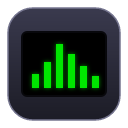
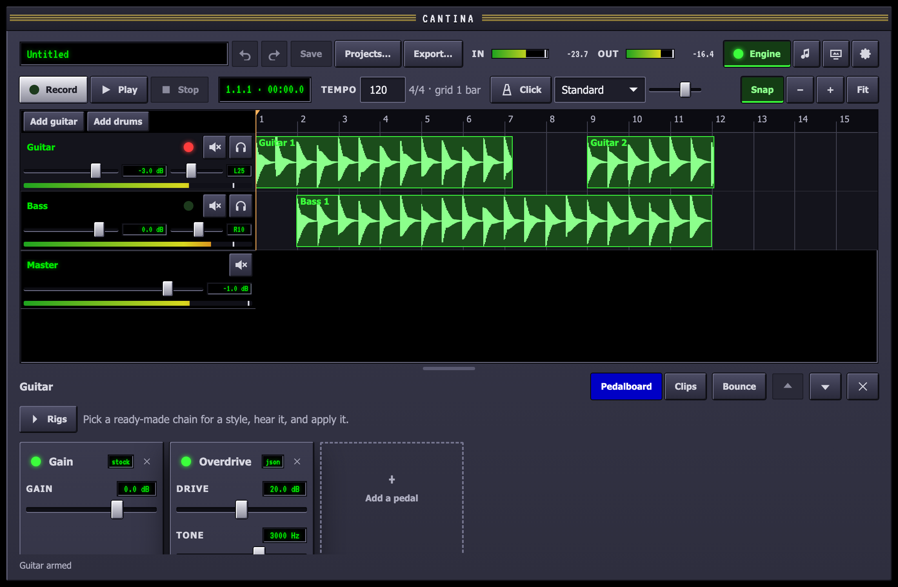
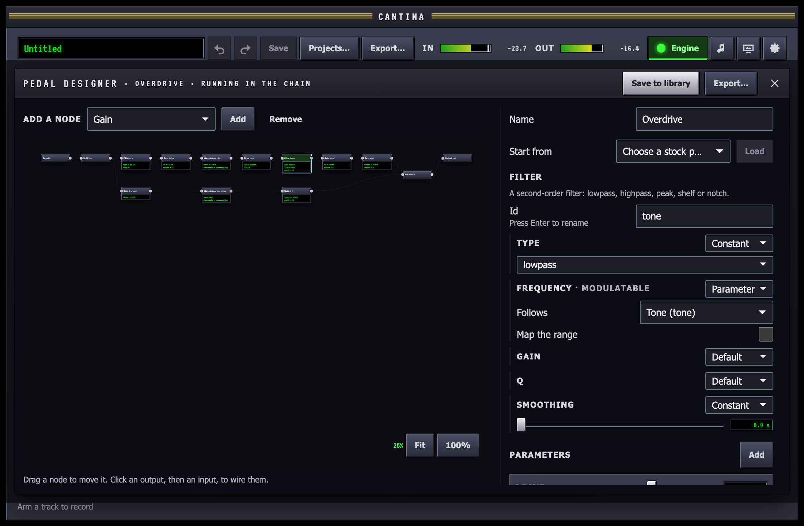
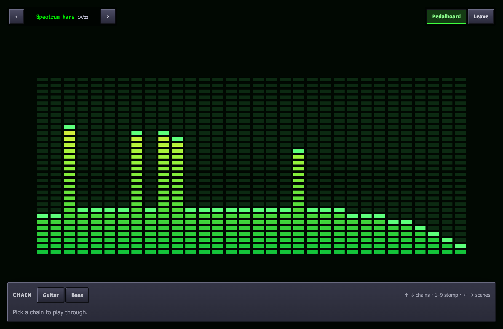

<p align="center">
  
</p>

# Cantina

A Mac desktop studio for guitar and bass players.

Plug in and play through a pedal chain with no perceptible delay. Layer
tracks on a timeline, build drum beats, run your Audio Unit and CLAP
plugins, design your own pedals as node graphs, and play on a full-screen
stage of music visualizer scenes that move with the beat.

Under the hood, a Rust engine on CoreAudio runs the audio thread without
allocating, locking or blocking. A React UI in a Tauri 2 shell sits on top.
Everything you make (pedals, kits, beats and projects) is a plain JSON
file, so you or a coding agent can write one and the app picks it up.

<p align="center">
  
</p>

<p align="center">
  
  &nbsp;
  
</p>

<p align="center"><sub>The studio, the pedal designer and the stage.</sub></p>

## Features

- **Real-time pedal chain.** Play through the chain live with a round trip
  of a few milliseconds on a class-compliant interface. Reorder, bypass and
  tweak pedals while you play; every parameter is smoothed so nothing
  clicks.
- **Stock pedals.** Tuner, noise gate, compressor, overdrive, distortion
  and fuzz (oversampled, with a blend for the clean signal), EQ, chorus,
  flanger, phaser, tremolo, an octaver and pitch shifter, tempo-synced
  delay, reverb, and an amp and cabinet with a starter set of impulse
  responses.
- **Multitrack recording.** Tracks and clips on a timeline: record, move,
  trim and split, with a mixer (gain, pan, mute, solo, master), a tempo map
  and metronome, undo and redo over the whole session, and autosave with
  crash recovery. Audio files are never modified.
- **Plugins.** Audio Units and CLAP plugins in any chain, with their own
  editor windows, saved state and latency compensation across tracks.
  Scanning runs in a child process, so a broken plugin cannot take the app
  down.
- **Drums.** A step sequencer with velocity, swing and pattern length,
  stock acoustic, rock, electronic and metal kits, and patterns as clips that
  follow the tempo map.
- **Pedal designer.** Build a pedal as a graph of filters, gains, shapers,
  delays and modulators, hear it live on your input as you wire it, and
  save it as a file you can share. Real-time safe by construction, with no
  compiler.
- **Stage.** Full-screen visualizer scenes in WebGL 2 and Canvas 2D, locked
  to the beat, with the pedalboard as stomp switches on the keyboard.
- **Six skins.** Classic, Midnight, Brushed metal, Hi-fi, Neon and Toxic.
  Skins change shape, material and displays, not only color.
- **Built for agents.** JSON Schemas for every format, a `cantina-cli` that
  checks a file and renders it through the app's own processors, a
  [`cantina-author`](.claude/skills/cantina-author/SKILL.md) skill for
  Claude Code, and library folders under `~/Music/Cantina` that the app
  watches. Ask for *"a fuzz with an octave-up blend"* and get a pedal that
  loads.

## Status

Released. Download the universal DMG from
[Releases](https://github.com/jbouder/cantina/releases/latest); the app
updates itself from there. It is not notarized by Apple yet, so the first
open needs **Open Anyway** in System Settings → Privacy & Security (the
[getting started](https://cantina-docs.vibeproject.workers.dev/guides/getting-started/)
guide walks through it). [CONTRIBUTING.md](CONTRIBUTING.md) is how to
help.

## Build from source

You need macOS 13 or later, [Rust](https://rustup.rs) (stable) and Node 22.

```sh
npm install
npm run tauri dev      # the app, rebuilding as the code changes
npm run tauri build    # target/release/bundle/macos/Cantina.app
```

`npm run dev` serves the UI alone in a browser against a stand-in engine,
which is enough for layout and skin work.

## Test

```sh
npm run check            # UI: Biome, color and contrast checks, TypeScript, tests
cargo test --workspace   # engine, DSP, hosting, project and CLI
```

[CONTRIBUTING.md](CONTRIBUTING.md) lists everything CI runs.

## Repository

| Path | What it is |
| --- | --- |
| `crates/engine` | CoreAudio stream, real-time graph runtime, transport and queues |
| `crates/dsp` | Pure audio processing: pedals, the pedal interpreter, the drum sampler |
| `crates/hosting` | Audio Unit and CLAP hosting, and the plugin scanner |
| `crates/project` | The project model, command log, undo and file format |
| `crates/cli` | `cantina-cli`: check, render and list what Cantina reads |
| `src-tauri/` | The Tauri 2 shell joining the engine to the UI |
| `ui/` | The React UI |
| `packages/` | `@cantina/scenes` (the visualizer) and `@cantina/skins` (the token system) |
| `pedals/`, `kits/`, `irs/`, `recipes/` | Stock pedals, drum kits, impulse responses and kit recipes |
| `schemas/` | JSON Schemas for every file format |
| `docs/` | The documentation site (Astro and Starlight) |

## Documentation

- [Getting started](https://cantina-docs.vibeproject.workers.dev/guides/getting-started/)
- [Guides](https://cantina-docs.vibeproject.workers.dev/guides/getting-started/):
  recording, pedals, the designer, drums, the stage, skins, latency
- [Authoring with an agent](https://cantina-docs.vibeproject.workers.dev/guides/agents/)
- [Architecture](https://cantina-docs.vibeproject.workers.dev/architecture/)
  and the [real-time rules](https://cantina-docs.vibeproject.workers.dev/architecture/real-time/)
- [API reference](https://cantina-docs.vibeproject.workers.dev/api/)
- [PLAN.md](PLAN.md): the decisions and the milestones
- [CONTRIBUTING.md](CONTRIBUTING.md)
- [AGENTS.md](AGENTS.md): working in this repository as an AI agent

## License

[MIT](LICENSE). Stock kits and impulse responses are credited in
[`kits/CREDITS.md`](kits/CREDITS.md) and [`irs/CREDITS.md`](irs/CREDITS.md).
