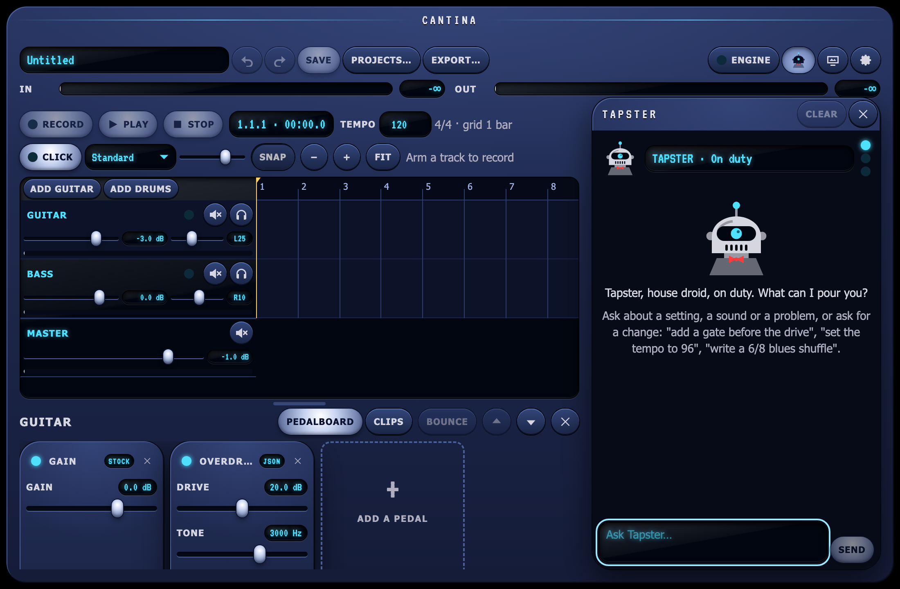
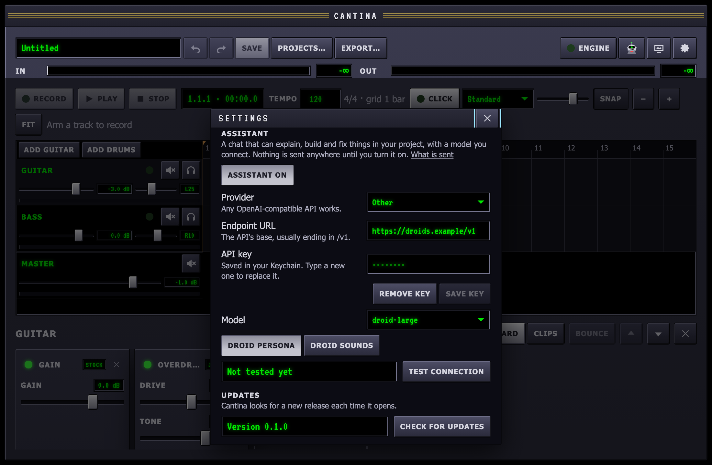
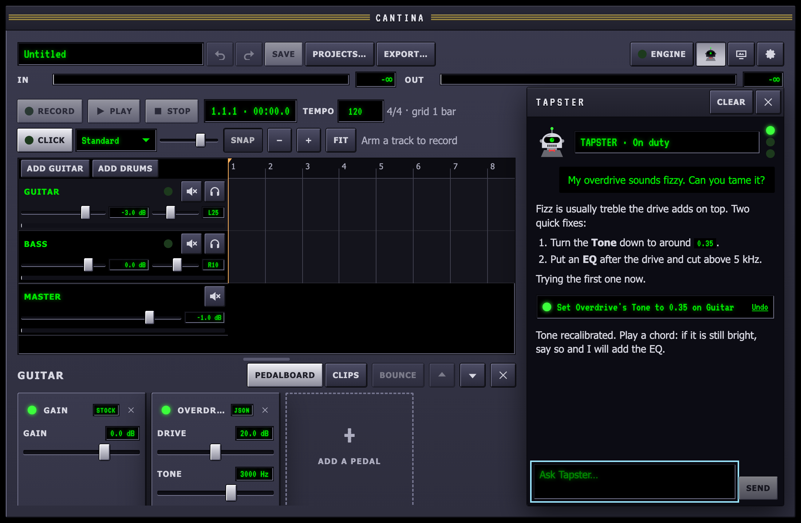

Cantina has an optional chat assistant. It is **off until you turn it on**,
and while it is off nothing is shown and nothing leaves your Mac. It works
with any service that speaks the OpenAI chat completions API, hosted or
running on your own machine. You bring the model and the key; Cantina has
no account or server of its own.

## Meet Tapster

The assistant is **Tapster**, the house droid who works the bar: an old,
well-kept service unit that has heard every band that ever played the
Cantina. It is helpful and a little dry, and talks like a droid when it
acts (*"Signal chain recalibrated."*), but its explanations stay plain and
correct. Tapster is Cantina's own character, drawn for the app.

Its console shows Tapster's face and a readout of what it is doing, with
three lights: **Link** (connected), **Busy** (thinking or writing) and
**Fault** (the last request failed). Tapster blinks while idle, scans
while thinking, talks while writing and goes red on a fault. With your
system's **Reduce motion** on (System Settings ▸ Accessibility ▸ Display),
it holds still.

In Settings ▸ Assistant:

- **Droid persona** (on by default). Off, the assistant answers plainly,
  without the droid's voice, and the panel is called **Assistant**.
- **Droid sounds** (off by default). On, Tapster chirps when a reply
  arrives and warbles on an error. The sounds are made in the window and
  play through your Mac's output. They never go through Cantina's audio
  engine, so they are never in a recording, an export or the stage.

## Connect a provider

Open **Settings** (the gear at the top right) and scroll to **Assistant**.

1. Press **Assistant off** so it reads **Assistant on**.
2. Pick a **Provider**, or choose **Other** and type the **Endpoint URL**
   yourself. It is the API's base address, usually ending in `/v1`.
3. Paste your **API key** and press **Save key**. A local model needs none.
4. Pick a **Model** from the list the endpoint offers. If the endpoint has
   no list, type the model's id.
5. Press **Test connection**.

Test connection says plainly what is wrong, if anything: a URL where
nothing answers, a key the provider refuses, a model it does not have, a
rate limit, or no network.

### A hosted API

| Provider | Endpoint URL | Key |
| --- | --- | --- |
| OpenAI | `https://api.openai.com/v1` | from platform.openai.com |
| Anthropic | `https://api.anthropic.com/v1` | from console.anthropic.com |
| OpenRouter | `https://openrouter.ai/api/v1` | from openrouter.ai |

A hosted provider bills your account for what the assistant sends and
receives, at its usual rates.

### A local model

A model running on your Mac keeps everything on your Mac.

- **Ollama**: install it, run `ollama pull llama3.2` (or any model that
  supports tool calls), and use `http://localhost:11434/v1` with no key.
- **LM Studio**: load a model, start its local server, and use
  `http://localhost:1234/v1` with no key.

Smaller local models answer more slowly and make more mistakes with
Cantina's tools than the large hosted ones.

## The chat panel

Once the assistant is on, with an endpoint and a model, a key with
Tapster's face appears beside **Engine** at the top right. Press it,
choose **View ▸ Tapster** (**View ▸ Assistant** with the persona off) or
press **⌘J** to open the chat at the right of the window; the same again
closes it.

- Type a message and press **Return** to send it (**Shift-Return** for a
  new line). The reply appears as it is written; **Stop** ends it there,
  keeping what was written so far.
- When the assistant changes your project, the change shows as a card,
  such as *Added Overdrive to Guitar*, with an **Undo** link. Undo works
  while that change is still the last thing that happened to the
  project; after anything else, use **Edit ▸ Undo**, which steps back
  through the assistant's changes like any others.
- Before anything that removes something, the panel asks, with **Yes**
  and **No**. Nothing is removed until you say yes.
- If a request fails (no network, a rate limit, a refused key) the reason
  shows in the thread with **Retry**.
- **Clear** forgets the conversation. Otherwise it is kept, and is there
  the next time you open Cantina.

## What it can read and change

The assistant works on the open project with the same edits the window
makes. Every change is one step in **Edit ▸ Undo**, saved with the project
and journalled like any other, and shows in the chat as a card.

It can **read**:

- the project: tempo, time signature and loop; every track with its
  pedal chain, each pedal's parameters with their values and ranges; the
  mixer; the clips and placed patterns;
- drum patterns, step by step;
- the pedals you can add (stock and your library) and the installed drum
  kits with their pads;
- the audio engine: whether it is running, the devices, sample rate,
  buffer size, latency, dropouts, the input and output meters, plugins
  that failed to scan and pedals that cannot be built;
- Cantina's guides and reference pages.

It can **change**:

- the tempo and time signature, and the loop;
- tracks: add an audio or a drum track, rename, arm, set the fader, pan,
  mute and solo (and the master's fader and mute);
- pedal chains: add a pedal (with its knobs set in the same step), remove,
  reorder, bypass, set parameters by name, and build a whole suggested
  chain in one step (it asks first);
- drum patterns: write a new one, rewrite one, and place it on a drum
  track at a bar.

It can also **write** new pedals, drum patterns and drum kits; see below.

It asks first, with **Yes** and **No** in the chat, before it **removes a
track**, **deletes a pattern** or **deletes a clip**. Audio files are never
deleted or changed; a deleted clip's recording stays in the project
folder.

It cannot record, play or stop, open plugins' windows, change your audio
devices, or save, open or delete projects.

## Tone and troubleshooting

Ask the questions you would ask another player:

- *"What does the Tone knob on my overdrive do?"* It reads the pedal and
  its settings, and explains them in Cantina's terms.
- *"How do I get a Gilmour-style lead?"* It suggests a chain from the
  pedals you have, with settings, and says why. **Nothing changes** until
  you say *"set it up"*; then it asks once more with **Yes** and **No**,
  and builds the whole chain as **one** step, so a single Undo puts your
  old chain back.
- *"Why does it crackle?"*, *"Why is there a delay?"*, *"Why is my input
  so quiet?"*, *"My plugin won't load"*. It reads the engine before it
  answers: whether audio is running, the devices, sample rate and buffer
  size, the round-trip latency, dropouts counted since the engine started,
  the input and output peaks, plugins that failed to scan, and pedals in
  the project that cannot be built. It answers from those numbers rather
  than guessing.

Its answers come from Cantina's own guides, built into the app, and link
to the page or section it used, such as [Latency](/guides/latency/) or
[Troubleshooting](/guides/troubleshooting/). Links open in your browser.

## Write pedals, beats and kits

Ask for something that does not exist yet and the assistant writes it:

- *"Make me a pedal like a Big Muff, with a mids knob"*: a pedal in
  Cantina's pedal format, saved to `~/Music/Cantina/Pedals`. It appears in
  the pedal picker under **Your pedals**; ask it to "put it on my guitar"
  and it adds it too.
- *"Write a 6/8 blues shuffle"*: a drum pattern, saved to
  `~/Music/Cantina/Patterns` and offered under **Import from the library**.
  Ask for it on a drum track and it adds it to the project and places it.
- *"A kit for lo-fi hip hop"*: a kit recipe, synthesised into a kit in
  `~/Music/Cantina/Kits`, which drum tracks can pick at once.

This is the [cantina-author](/guides/agents/) skill's loop, in the app.
The assistant is given the same format references and examples, and every
file it writes goes through the same code as `cantina-cli`:

1. **Check**: the format's schema and the rules the app enforces. A
   pattern is checked against the pads of the kit it will play on.
2. **Render**: a pedal is run over a guitar DI and must not clip, be
   silent or carry DC at its defaults; a pattern is played through its kit
   and must make a sound; a kit is synthesised and checked.
3. **Save**, only if both pass. The library folders are scanned at once,
   so the new file is in the pickers straight away.

A file that fails is **never saved**: the assistant gets the problems and
tries again, up to three times per message, then tells you what kept
failing. It never overwrites a pedal or pattern of yours without asking,
and never replaces an installed kit.

Writing files sends the format references (about 30 KB of text) with
every message, so each request is larger than a plain chat.

## Where your key is kept

Your API key goes into the macOS **Keychain**, under
`com.jbouder.cantina.assistant`. It is never written to a project, to
Cantina's settings file or to a log, and once saved it is never shown
again: Settings only says that one is saved. Press **Remove key** to
delete it from the Keychain. You can also see or delete it in the
Keychain Access app.

The requests themselves are made by Cantina's native side, not by its
window, so the key never travels back into the interface.

## What is sent, and when

Nothing is sent while the assistant is off. With it on, Cantina contacts
the endpoint only:

- to list its models, when you open Settings or change the endpoint or key;
- when you press **Test connection**;
- when you send a message, press **Retry**, or the assistant carries on
  after a change it made.

Each message sends your key, a short description of the assistant, a
summary of the project (its name, tempo and track names), and the
conversation so far: your messages, its replies, and what its tools read
and changed. When it reads the project or the engine, those details
(track and pedal names and settings, clip and pattern names, device names
and levels) are sent as part of the conversation. Older parts of a long
conversation are left out. No audio and no file is ever sent.

The conversation is kept on your Mac in
`~/Library/Application Support/com.jbouder.cantina/assistant-thread.json`
until you press **Clear**.

## Turn it off

Press **Assistant on** again in Settings. Nothing is shown or sent from
then on. Your endpoint and model are remembered for next time; remove the
key too if you want it gone.
