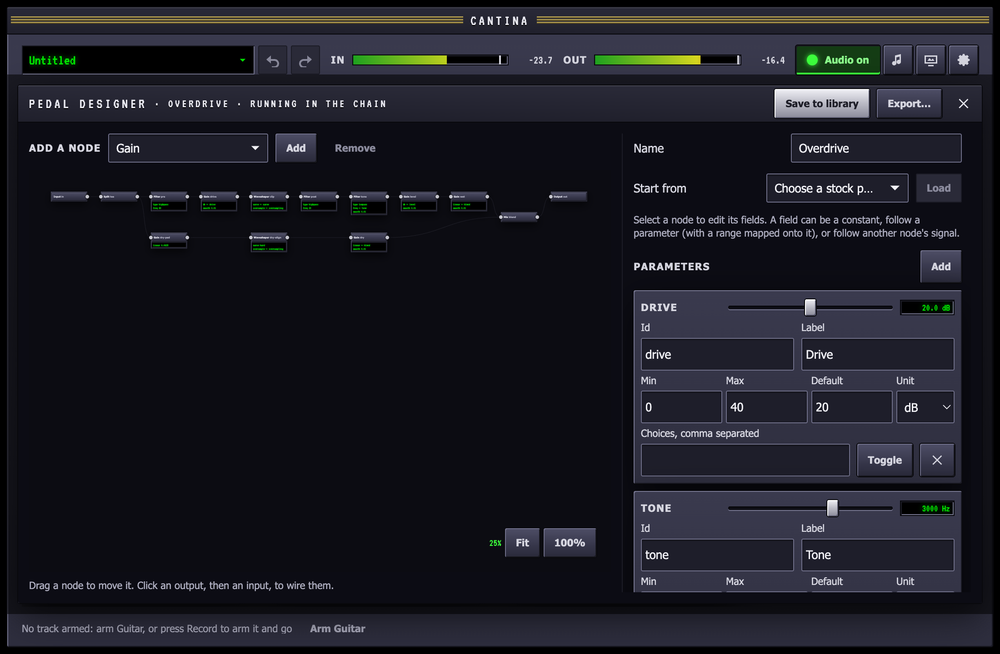

The designer builds a pedal from parts (gains, filters, waveshapers, delays,
oscillators) on a canvas, while it plays in the chain. Every change is heard
on your input as you make it.

## Start a design

- **New design…** in the pedal picker adds an empty pedal to the end of the
  chain, an input wired straight to an output, and opens it.
- **Edit…** on one of your pedals' cards opens that one.
- **Start from** in the side panel loads any stock pedal marked *json* as a
  starting point. The overdrive is a good first look.

## The canvas

Each part is a card. **Add a node** puts a new one on the canvas.

- **Drag** a card to arrange it, or focus it and use the arrow keys (Shift
  for single pixels).
- **Wire** two cards by clicking an output port on the right of one, then an
  input port on the left of another. A card takes one wire in, except a
  **mix**, which sums every wire into it.
- **Delete** removes the selected card or wire.
- **Dashed lines** show one card's signal driving another's setting, such as
  an oscillator sweeping a filter. An oscillator has no output port, because
  it carries no audio: you connect it from the side panel instead.

## Settings and knobs

Select a card to edit its settings in the side panel. Each setting can be:

- **a constant**, set with a fader, a pick or a switch
- **a parameter**: one of the pedal's knobs, with the knob's range mapped
  onto the setting's, in a straight line or on a log scale for frequencies
- **a signal** from another card, such as an oscillator, for settings that
  can move while audio plays

**Parameters** are the knobs the pedal shows on its card in the chain. Each
has an id, a label, a unit, a range and a default, or a list of choices, or
is a switch. Each has a live fader in the panel too, so you can try it as you
build.

## When something is wrong

A design that cannot play, such as a card left unwired, a loop, or a setting
out of range, shows its problems in the side panel and outlines the
cards they are about. The last version that worked keeps playing until you
fix it, so a mistake never cuts the sound.

## Save and share

- **Save to library** keeps the pedal in `~/Music/Cantina/Pedals/`. It then
  shows in the picker under *Your pedals*, with a *yours* badge.
- Adding a library pedal to a chain copies it into the project, so the song
  keeps its sound even if you change the library pedal later.
- **Export…** writes the pedal to a `.pedal.json` file to send to someone.
- **Import a file…** in the picker, or dropping a `.pedal.json` on the
  window, adds a pedal to your library and to the selected track's chain.

A pedal is a small JSON file; the [pedal format](/reference/pedal-format/)
reference describes every part and setting.

### Files written outside Cantina

`~/Music/Cantina/Pedals/` is also where to put a pedal written by hand or
by a coding agent. Cantina watches the folder: a `<id>.pedal.json` saved
there appears in the picker under *Your pedals* within a second, without a
restart. A file that does not load is listed under the pedals as *will not
load*, with the reason, and cannot be added until it is fixed; the reason
is the one `cantina-cli check` gives (see the
[command line](/reference/cli/)). A pedal already in a chain keeps the
copy the project took when it was added.
