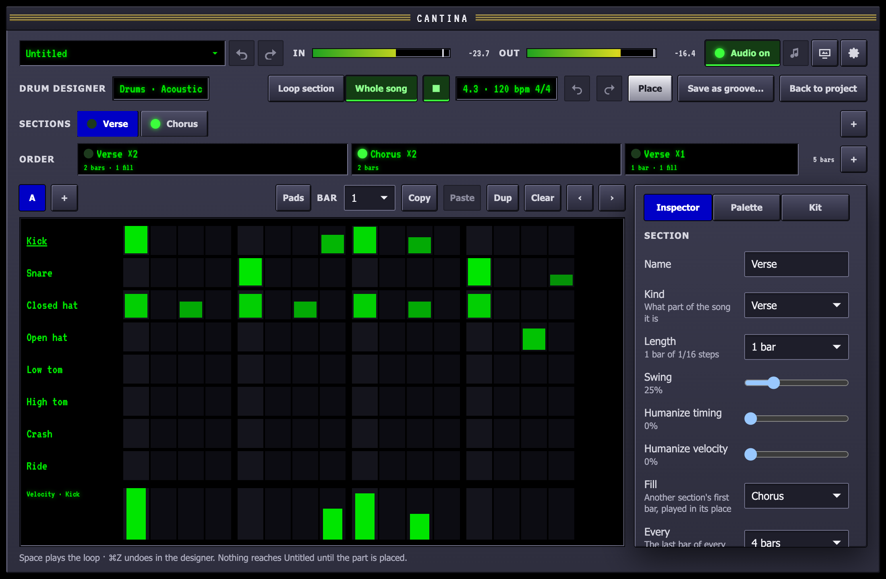
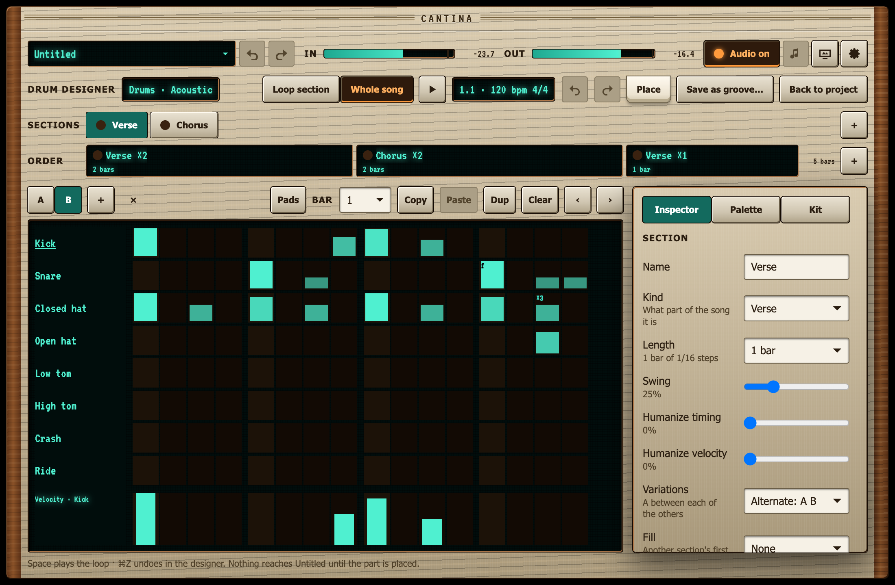
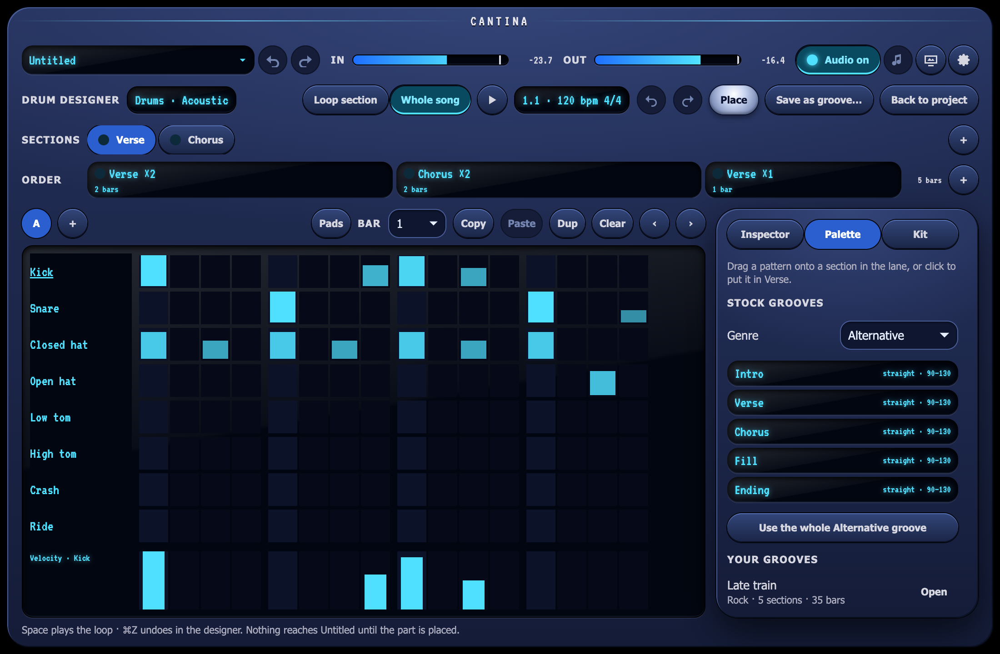
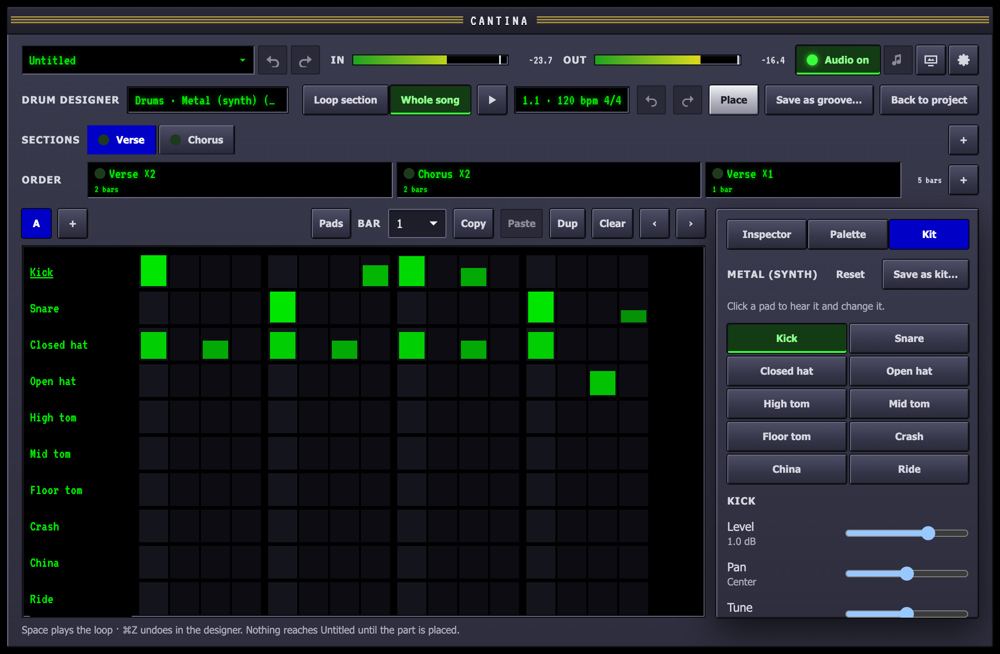
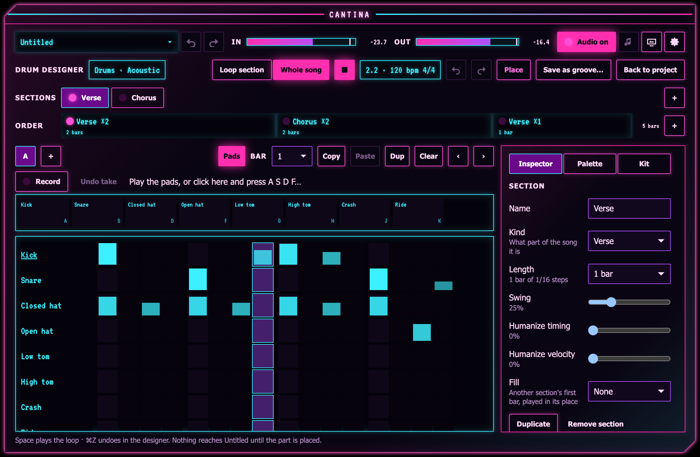
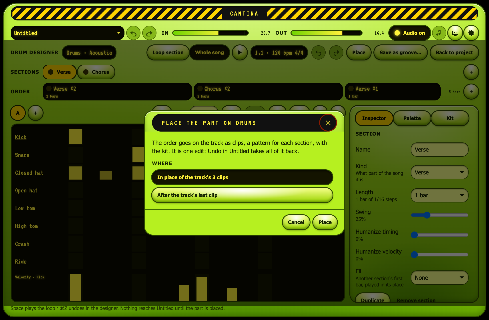

The Beats tab is a strip under the timeline, and a drum part is a whole
song's worth of work. The **drum designer** gives it the window: the
kit's pads down the left, a large grid in the middle, an inspector on
the right and a transport of its own.

## Opening it

Open it on a drum track in any of three ways:

- **Design…** in the track's Beats tab.
- **View ▸ Drum Designer**, which opens it on the selected drum track,
  or the first one.
- **⌘B**.

It opens with the track's kit and patterns. Each pattern the track's
clips play becomes a **section**, named after the pattern, and the clips
in order become the part's **order**: two Verse clips of two bars each
followed by a Chorus clip read as *Verse ×4, Chorus ×2*. A track with no
clips gets a section for each of the project's patterns, and a project
with none an empty verse.

## A copy, heard on its own

The designer works on a **copy** of the part. While it is open the
engine hears the part instead of the project, as it hears a jam: the
part on a drum track of its own, through the track's kit, pad mixer and
fader, at the project's tempo and time signature, with the click if the
metronome is on. The track's pedals are not in the designer.

Nothing you do in the designer changes the project. **Back to project**
(or Esc, or ⌘B again) closes it, and the project is heard again with its
playhead where it was. If the part has changes that are not on the
track, the designer asks first: **Leave without placing** drops them.

## The transport

- **Loop section** plays the section you are editing round and round,
  long enough for its fill to come round.
- **Whole song** plays the order from the top and loops at its end.
- **Play** (Space) starts the loop from the top; Space again stops it.
  The readout shows the bar and beat, the tempo and the time signature.

## The grid and the inspector

Click a cell to put a hit there, or click a hit to take it away; drag
across cells to paint or erase a run. With a cell focused, the arrows
move and Space or Return toggles it. The column under the playhead lights
while the section plays.

The inspector sets the section's **name** (the order and fills follow a
rename), its **kind** (intro, verse, chorus, bridge, fill, ending or your
own), its **length** in bars, its **swing** and its **fill**.

## Sections and the order

Two lanes run across the top.

**Sections** lists the part's sections; the grid edits the one chosen.
Keys **1** to **9** choose the first nine. **+** adds a section: an intro,
verse, chorus, bridge, fill or ending, named after its kind, or one of
your own to name in the inspector. A new section is an empty pattern as
long as the one you were editing; a fill starts as one bar. Each section
has a pattern of its own length. In the inspector, **Duplicate** copies the section
as "Verse 2", and **Remove section** takes it out with its steps in the
order and any fills that came from it.

**Order** arranges the sections into a song. Each step plays a section a
number of times, as wide in the lane as it is long: *Verse ×4, Chorus
×2, Verse ×2, Ending ×1*. Under each step are its bars and how many of
them play a fill, and the total is at the end of the lane. **+** at the
end adds the section you are editing. Click a step to show it in the
inspector, where you can change what it plays and how many times, move it
earlier or later, remove it, or **Play from here**.

A section can play a **fill**: the first bar of another section played
in its place on the last bar of every 2, 4, 8 or 16, and on its last bar
in each step of the order with **At its end**, just as a pattern clip's
fills do on the timeline. Looping a section alone, the loop runs long
enough for its fill to come round.

### Changing what plays

While the part rolls, choosing another section to loop, **Whole song**,
or **Play from here** lands on the next bar line, as a jam's sections
do: what is playing carries on to the bar, and the new part starts on it.
Stopped, the change is where play starts next time.

Edits to the sections and the order are part of the designer's history,
so **⌘Z** takes them back like any other.

## Pattern tools

**Each hit** can be more than on or off. With a cell focused:

- **G** plays it as a **ghost note** (30%), **A** as an **accent** (full);
  **⇧↑** and **⇧↓** make a hit 10% harder or softer.
- **R** steps its **roll**: 1 to 4 hits in the step (a ratchet, shown ×2,
  ×3, ×4). **F** gives it a **flam**, a soft grace note just before (f).
  **C** steps its **chance** of playing on a pass: 100, 75, 50 and 25%,
  the cell dimming with it.
- **⌫** clears it; **[** and **]** shift every hit of the pattern a step
  earlier or later, round the ends.

**The velocity lane** under the grid shows one pad's hits as bars: click
a pad's name, or focus one of its cells, to choose it. Drag across the
lane to draw the velocities, as high as the pointer; it only changes hits
that are there, and never takes one away.

**Bars**: above the grid, pick a bar, then **Copy** it (every pad),
**Paste** a copied bar over it, **Duplicate** it (a copy goes in after
it, and what followed moves a bar later), or **Clear** it. **‹** and **›**
shift the whole pattern a step.

**Variations**: **A** is the section's pattern. **+** adds a variation,
**B**, **C** and then **D**, each a copy of the one shown to change; **×**
removes the one shown. The inspector's **Variations** sets how they take
turns, a pass of the pattern each: **Alternate** plays A between each of
the others (A B A C A D), **Chain** one after another (A B C D). The
variations are always the same steps as A: a length set in the inspector
applies to them all, as do the **swing** and the **humanize** (how far
hits stray from the grid in timing and in velocity). The grid lights only
on the passes of the variation it shows.

The designer keeps a history of its own: **⌘Z** and **⇧⌘Z**, or the
arrows in its toolbar, step back and forward through your edits in the
designer without touching the project's.

## The palette and groove files

**Palette**, beside **Inspector** at the top of the side panel, is where
a part starts quickly.

- **Stock grooves**, a genre at a time: each of the genre's sections with
  its feel and the tempos it suits (and its time signature, when it is
  not the project's). Drag one onto a section in the lane, or click it to
  put it in the section you are editing; the section keeps its name.
  **Use the whole … groove** puts every one of the genre's sections into
  the part at once: each into the section of its kind, or a new one. An
  empty order becomes a song of them (intro, verse, chorus, verse, chorus,
  bridge, chorus, ending, of those there are), and a verse or chorus with
  no fill takes the genre's fill every four bars.
- **Your grooves**: parts you saved. **Open** puts one in place of the
  part, its sections, order and kit (the track's kit stays when the
  groove's is not installed).
- **Your patterns**: the pattern files in Patterns in your Cantina folder,
  to drag or click in the same way.

All of it is part of the designer's history: **⌘Z** takes it back.

**Save as groove…** in the toolbar writes the whole part (its sections
with their patterns, fills and variations, the order and the kit, at the
project's tempo and time signature) to
`~/Music/Cantina/Grooves/<name>.groove.json`. It joins **Your grooves** in
the palette, and the [Jam](/guides/jam/#setting-it-up) view's **Groove**
list, where each of its sections plays by kind. The stock grooves stay as
they are. The file is the [groove format](/reference/groove-format/):
write one by hand or [with an agent](/guides/agents/), and
`cantina-cli check` it.

## The kit workbench

**Kit**, the third tab of the side panel, is the kit's side of the part.
Click any pad to hear it.

**Change the kit** opens a copy of the part's kit to work on, heard as it
changes; the kit's own folder is never touched. For the pad you clicked:

- **Level**, **Pan**, **Tune** (±12 semitones) and **Decay** (how much of
  each hit rings), each taking effect when you let go of the slider, and
  its **Choke group**: a hit cuts the others in its group, the closed hat
  silencing the open one.
- **Samples**: **From a file…** puts a WAV file on the pad; **From a kit**
  and **Use** put another kit's pad there, every velocity layer of it.
- **Recipe**: a kit made from a recipe (the stock Metal, Jazz, Vintage
  and others, or one you saved) shows the pad's **Pitch**, **Length**,
  **Tone** and **Noise**; changing one synthesizes the kit again.

**Reset** puts the kit back as it was. **Save as kit…** writes it to
`~/Music/Cantina/Kits/<name>/` (its `kit.json`, every sample, and the
recipe when it has one), where every drum track's **Kit** list and
`cantina-cli check` find it, and the part plays it from then on. The
pads' settings are the [kit format](/reference/kit-format/)'s, version 2.

## Playing a part in

Some parts are played, not drawn. **Pads**, above the grid, opens the
kit as pads: click one (harder toward its top), or click into the strip
and press **A S D F G H J K L ;** and then **Z X C V B N** for the kit's
pads in order, **⇧** for an accent at full strength.

**Record** loops the section you are editing (from the next bar if
something else is playing) and, from a stop, starts after a bar of
count-in when **Count in** is on. What you play is:

- **quantized** to the nearest step of the section's grid, a hit just
  before the loop comes round going to its first step;
- **compensated** for the output's latency: a hit counts where the beat
  you heard was, not where the playhead had got to;
- **overdubbed**: each hit is kept at the louder of what was there and
  what you played, and nothing is taken away;
- recorded into the **variation** that pass plays, when the section has
  variations.

Each pass round the loop goes in as one **take**, one step of the
designer's history: **Undo take** (or ⌘Z) takes back the last. **Record**
again stops, keeping what was played in the pass under way.

## Placing the part

**Place**, the toolbar's one primary button, puts the part on the drum
track you opened the designer from: a pattern for each section (named
after the track and the section, with a whole round of its variations),
a pattern clip for each step of the order with the section's fill, and
the part's kit. Clips are in bars, so they stay on them whatever the
tempo does.

When the track already has clips, Place asks where:

- **In place of the part placed before** takes out what the last Place
  put there (its clips, and its patterns nothing else plays) and puts
  the part where it started. The first time, it replaces the track's
  clips, from the first of them.
- **After the track's last clip** starts the part on the next bar line
  after everything else on the track.

It is one edit: **Edit ▸ Undo** in the project takes all of it back. The
designer stays open, the part now the track's, and leaving no longer
asks. Open the designer on the track later and it has the part as you
placed it, sections, variations and all, ready to revise and place
again. A kit changed in the workbench must be saved (or reset) first,
since a placed part plays an installed kit.
