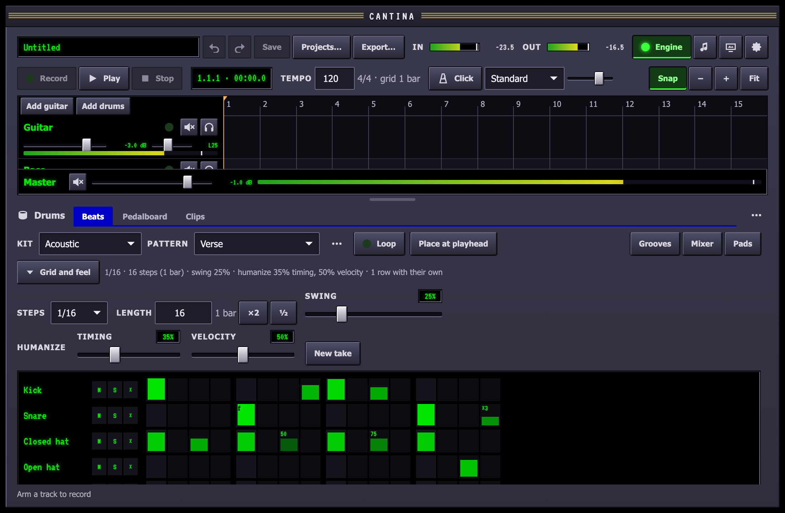
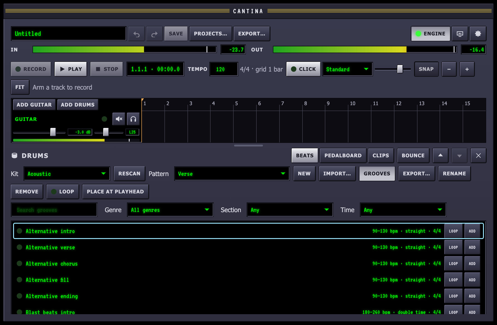
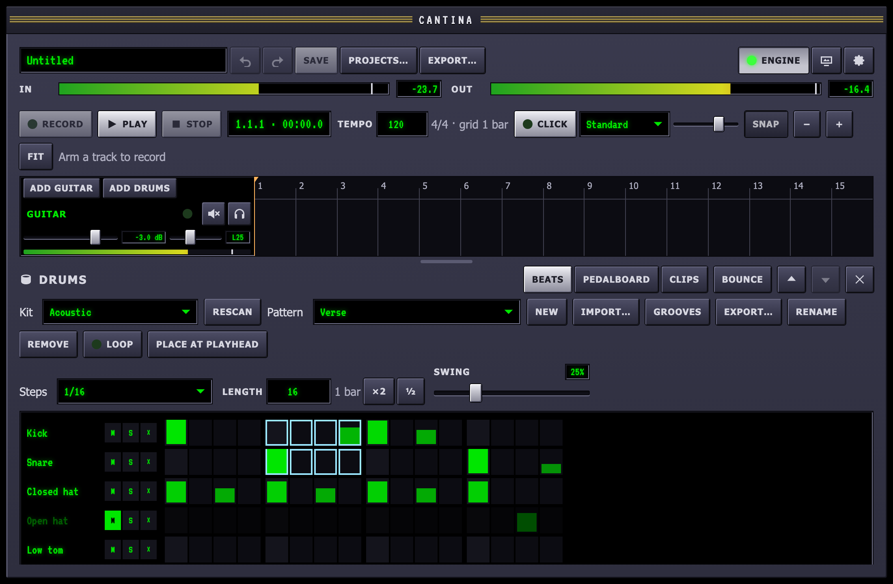
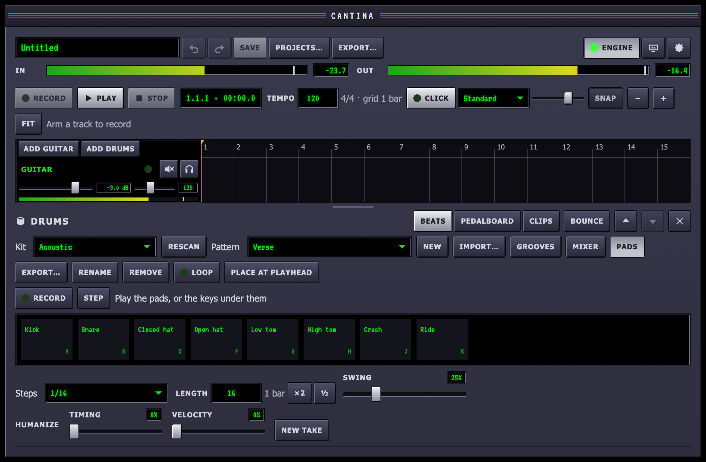
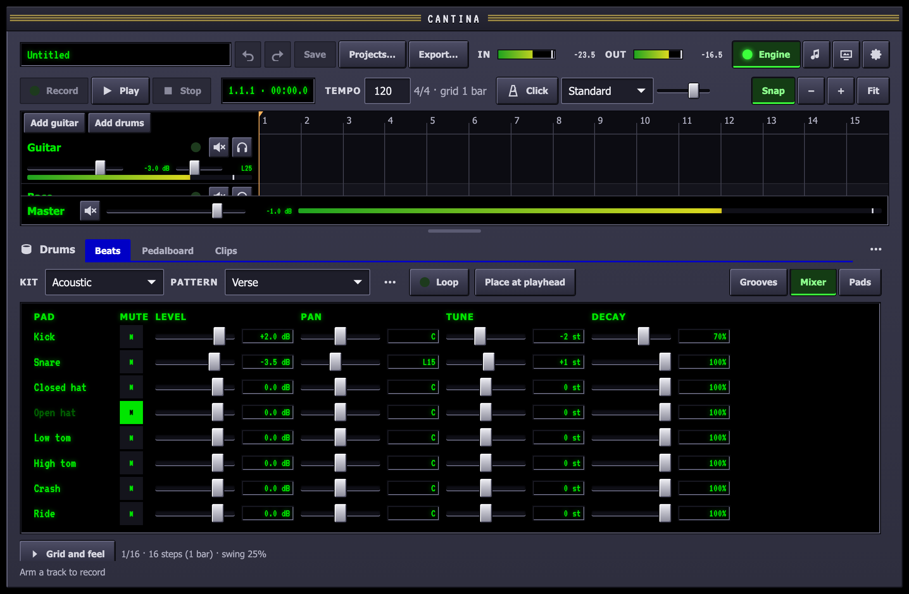
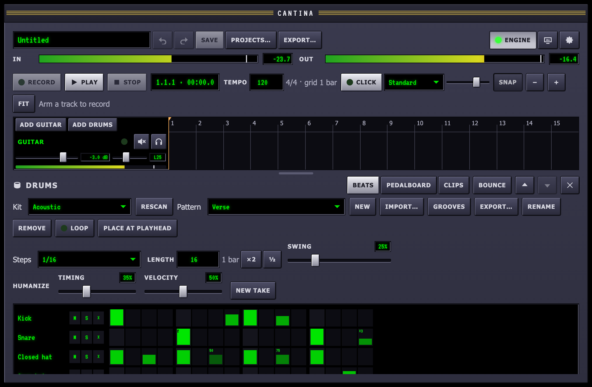
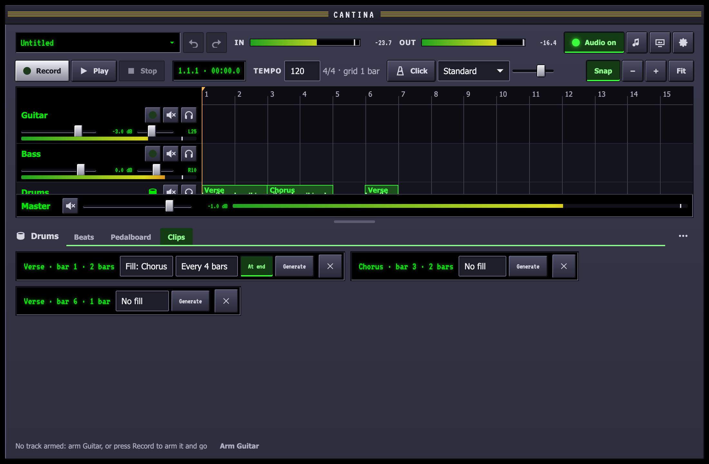

A drum track plays **patterns**, step grids you program, through a **kit** of
drum sounds. You place a pattern on the timeline as a clip, and it follows
the tempo.



## Add a drum track

**Add drums** above the track headers adds a drum track with the first kit
found. Select it to see its **Beats** tab below the timeline. A drum track has
no input to arm; it has a pedalboard like any other track, so a drum bus
can go through a compressor or a reverb.

## Kits

Pick a kit from **Kit**. Four come with Cantina:

| Kit | Sounds |
| --- | --- |
| Acoustic | Kick, snare, closed, pedal and open hats, three toms, crash and ride, each drum with a soft and a hard hit |
| Tight rock | A heavy kick, a hard snare, closed and short open hats, two toms, crash, ride and cowbell |
| Electronic | Two kicks, two snares, a clap, hats, two toms and percussion |
| Metal (synth) | A short, clicky kick and a cracking snare with three velocity layers each for fast doubles, tight hats, three toms, crash, china and ride. Synthesised from `recipes/metal.recipe.json` |

Every kit has the same names for the kick, snare, hats and toms, so a
pattern written on one plays on the others. The open hat is cut off by the
closed one, as on a real kit.

To make your own kit, copy one of the stock kits from `kits/` in the
repository to `~/Music/Cantina/Kits/` and swap the samples (or bring in a
kit folder with **File ▸ Import Kit…**, which checks it loads first), or describe one
as a [kit recipe](/reference/kit-format/#kit-recipes) and let
`cantina-cli synth-kit` make the samples. The
[kit format](/reference/kit-format/) describes every field.

## Stock grooves

Cantina comes with 87 grooves in 17 genres, so a drum track can play
something good straight away. They are in the **Pattern** menu, under
**Add a groove**, one group per genre, with the tempos each suits, and in the groove
browser below. Choosing
one copies it into the project as a pattern of its own, which you can then
edit like any other; the groove that ships with the app never changes.

| Genre | Sections | Tempo (bpm) | Feel | Time |
| --- | --- | --- | --- | --- |
| Alternative | intro, verse, chorus, fill, ending | 90–130 | straight | 4/4 |
| Blast beats | intro, verse, chorus, fill, ending | 180–260 | double time | 4/4 |
| Blues shuffle | intro, verse, chorus, fill, ending | 75–130 | shuffle | 4/4 |
| Djent | intro, verse, chorus, fill, ending | 100–140 | half time | 4/4 |
| Funk | intro, verse, chorus, fill, ending | 88–116 | straight | 4/4 |
| Grunge | intro, verse, chorus, fill, ending | 80–120 | straight | 4/4 |
| Half-time | intro, verse, chorus, fill, ending | 70–100 | half time | 4/4 |
| Hard rock | intro, verse, chorus, fill, ending | 110–150 | straight | 4/4 |
| Heavy metal | intro, verse, chorus, fill, ending | 130–180 | straight | 4/4 |
| Hip-hop | intro, verse, chorus, fill, ending | 80–98 | swing | 4/4 |
| Jazz | intro, verse, chorus, fill, ending, and a waltz (bridge) | 100–220 | swing | 4/4, 3/4 |
| Metalcore | intro, verse, chorus, bridge (breakdown), fill, ending | 120–170 | straight, half time | 4/4 |
| Pop | intro, verse, chorus, fill, ending | 95–125 | straight | 4/4 |
| Punk | intro, verse, chorus, fill, ending | 160–210 | double time | 4/4 |
| Reggae | intro, verse, chorus, fill, ending | 66–90 | shuffle (one drop) | 4/4 |
| Rock | intro, verse, chorus, fill, ending | 95–140 | straight | 4/4 |
| Thrash | intro, verse, chorus, fill, ending | 170–240 | double time | 4/4 |

### Browse and hear grooves

**Grooves**, beside **Import…**, opens the groove browser under the
pattern controls.



- **Find one**: type in the search box (it matches the name, genre,
  section, feel and time signature), or narrow the list by **Genre**,
  **Section** and **Time**.
- **Hear it**: **Loop** plays the groove on this track's kit at the
  project's tempo, round and round, without adding it. While the song is
  playing it starts on the next bar line; from a stop it starts at once,
  from the playhead. **Loop** again, or **Stop**, ends it.
- **Add it**: **Add** (or a double-click) copies the groove into the
  project and shows it in the grid. **Drag a groove onto the timeline**
  to add it and place it on that drum track where you drop it.
- **From the keyboard**: the list is one stop; ↑ and ↓ move through it,
  Page Up and Page Down move faster, Space loops the groove, Return adds
  it and Esc stops the loop.

A **fill** is one bar that leads into the next section; place it on the
last bar before the change. An **ending** is the last hit, left to ring.
Every groove uses the pad names all the kits share (`kick`, `snare`,
`hh-closed`, `hh-open`, the toms, `crash`, `ride` and `china`); on a kit
without one of them, that row is silent.

A new drum track starts with its fader at **−12 dB**. The stock kits'
samples are full-scale, so a kick and a snare together at full strength
are twice as loud as either; the headroom keeps even the densest groove
clear of clipping. Turn the fader up if a quieter pattern needs it.

## Program a pattern

A pattern belongs to the project, so any drum track can use it. **New**
makes one; **Rename** and **Remove** do what they say.

- **Click** a cell to add a hit at full strength, or to remove one.
- **Drag up or down** on a cell to set how hard it hits. The fill shows it.
- **Drag across** cells to paint hits along the way, or, starting on a
  hit, to erase them. A stroke can cross rows.
- From the keyboard, the arrow keys move around the grid, Space or Enter
  toggles a cell, Shift with ↑ or ↓ changes the strength by 10%, and Home
  and End jump to the ends of a row.

### Edit faster

- **Select** with ⇧-click or ⇧-drag, or from the keyboard with ⇧← and ⇧→
  (and ⌥⇧↑, ⌥⇧↓ for more rows). Esc clears the selection.
- **Copy, cut and paste** with ⌘C, ⌘X and ⌘V: paste puts the copied
  cells with their corner at the focused cell. With nothing selected, they
  act on the focused cell.
- **Duplicate** with D: the selection is copied to just after itself,
  growing the pattern if it must. With nothing selected, D doubles the
  pattern.
- **Shift** with [ and ]: moves the selection (or the focused row) a step
  left or right, wrapping round, so a hit pushed off one end comes back
  at the other.
- **Clear** with ⌫ (the selection or the focused cell), ⌥⌫ for the whole
  row, or the row's **×**.
- **Double and halve**: **×2** beside **Length** plays the pattern twice
  in a row, twice as long; **½** (or H) keeps the first half.
- **Mute and solo rows** with the row's **M** and **S**, or M and S on
  the keyboard, to hear a part on its own while you edit. They are for
  listening only: the pattern, the project and an export are unchanged.

Every gesture is one step of **Undo**.



Above the grid:

- **Steps** sets the size of a step: from quarter notes to 1/32, with
  triplets.
- **Length** is the number of steps before the pattern repeats, up to 128.
  The size in bars and beats is shown beside it.
- **Swing** delays every second step, up to a triplet feel at 100%.

### Pattern files

A pattern can also live outside a project as `<name>.pattern.json`: the
same object the project holds, without its id. The
[pattern schema](/schemas/pattern.schema.json) describes it.

```json
{
  "name": "Half-time",
  "stepsPerBeat": 4,
  "length": 16,
  "swing": 0,
  "rows": [
    { "pad": "kick", "steps": [1,0,0,0, 0,0,0,0, 0,0,0,0, 0,0,0,0] },
    { "pad": "snare", "steps": [0,0,0,0, 0,0,0,0, 1,0,0,0, 0,0,0,0] },
    { "pad": "hh-closed", "steps": [0.8,0,0.5,0, 0.8,0,0.5,0, 0.8,0,0.5,0, 0.8,0,0.5,0] }
  ]
}
```

Each row has exactly `length` velocities from 0 (no hit) to 1, and names a
pad by the id kits use.

A stock groove's file also has a `groove` object saying what it is for.
Cantina reads it to sort the groove into the menu and leaves it behind
when the groove is added to a project:

```json
"groove": {
  "genre": "Rock",
  "section": "verse",
  "timeSignature": { "numerator": 4, "denominator": 4 },
  "tempo": { "min": 95, "max": 140 },
  "feel": "straight"
}
```

- **`section`** is `intro`, `verse`, `chorus`, `bridge`, `fill` or
  `ending`.
- **`timeSignature`** is the groove's meter; the pattern must be a whole
  number of its bars.
- **`tempo`** is the range of tempos it suits, from 20 to 400 bpm, the
  slower first.
- **`feel`** is `straight`, `shuffle`, `swing`, `half-time` or
  `double-time`.

- **Export…** writes the pattern shown to a `.pattern.json` file.
- **Import…** adds pattern files to the project, as does dropping one on
  the window. An imported pattern gets a new id, and a name already in the
  project gets a number after it (`Beat 2`). Rows for pads the track's kit
  does not have are kept, so the pattern still plays them on another kit,
  and a notice names them.

## Play and record the pads

**Pads**, beside **Mixer**, shows the kit as pads to play: click one
(higher on the pad is harder), or with a pad focused use the keys under
them, **A S D F G H J K L ;** for the first ten pads in the kit's order
and **Z X C V B N** for the next six; ⇧ plays an accent. A hit goes
straight to the drum track's sampler and sounds at once, through the
track's pedals, whether the song is playing or not.

- **Record** loops the pattern shown from the top and starts playing.
  Play along: each hit lands on the nearest step, and when the pattern
  comes round, what you played that pass is added to it as one step of
  **Undo**, keeping the louder hit where one was already there. Keep
  playing to add more on the next pass; press **Record** again, or Esc,
  to stop.
- **Step** writes a hit at a cursor, then moves the cursor on a step,
  for programming a beat one hit at a time without a tempo; ← and →
  move the cursor. Each hit is one step of **Undo**.



## The pad mixer

**Mixer**, beside **Grooves**, opens the pad mixer: for each pad of the
kit, without editing the kit,

- **M** mutes the pad.
- **Level** from −60 to +12 dB.
- **Pan**, added to where the kit puts it.
- **Tune** up or down a fifth and more, ±12 semitones, for a deeper kick
  or a higher snare.
- **Decay**: how much of each hit rings, down to 5%; a shorter decay
  tightens a boomy kick or a washy cymbal.

The settings are saved with the drum track. Level and mute change
smoothly, even while a hit rings; pan, tune and decay take effect from
the next hit. Double-click a fader to put it back to the kit's own, and
every change is one step of **Undo**.



## Feel

Grid-perfect drums sound programmed. Under the pattern controls:

- **Humanize**, **Timing** and **Velocity** move every hit a little off
  the grid (up to about a sixty-fourth note) and a little softer or
  harder (up to 30%). Each pass of the pattern is slightly different, and
  the same every time it plays, so a song sounds the same on every play
  and every export. **New take** rolls it again.
- For the row the focus is on, **Own swing** gives it a swing of its own,
  hats swung with a straight kick for instance, and **Own humanize** its
  own amounts.

On a step (or a selection), from the keyboard:

- **C** steps its **chance** through 100, 75, 50 and 25%: on each pass
  the hit plays or not, the same way every time. The cell shows the
  chance and is dimmer.
- **R** steps a **ratchet** through 1 to 4 hits in the step, for rolls and
  hat stutters; the cell shows ×2 to ×4.
- **F** turns a **flam** on or off: a soft grace note just before the
  hit; the cell shows f.

Every change is one step of **Undo**, and travels with the step when you
copy, shift or duplicate it.



## Fills

A loop that never changes sounds like a loop. Any pattern clip can play a
**fill**, another pattern, on some of its bars. In the **Clips** tab, each
pattern clip has:

- **Fill**: the pattern to play on fill bars, or **No fill**.
- **Every 2, 4, 8 or 16 bars**: the last bar of each group is a fill
  (counted from the clip's start), or **Not repeating**.
- **At end**: the clip's last bar is a fill, leading into whatever comes
  next, such as the chorus.
- **Generate**: writes a new fill from the clip's own pattern, on this
  track's kit, and picks it, playing every four bars and at the end (or
  as the clip already had it). The groove plays for the first beat or
  two of the bar, then breaks into a snare roll, a run down the toms,
  snare and toms in turns, or kick-and-snare accents. Press it again for
  another. The fill is an ordinary pattern, called "<pattern> fill",
  that you can open in **Beats** and edit.

A fill bar plays the first bar of the fill pattern, and the clip's own
pattern carries on afterwards where it would have been. Stock grooves come
with a fill for each genre, which you can add and choose here too. Every
change is one step of **Undo**.



## Library folders

Cantina watches three folders for files written outside the app, by hand
or by a coding agent:

| Folder | Holds |
| --- | --- |
| `~/Music/Cantina/Kits/` | Kit folders, each with a `kit.json` and its samples |
| `~/Music/Cantina/Patterns/` | `*.pattern.json` files |
| `~/Music/Cantina/Pedals/` | `*.pedal.json` files (see [designing pedals](/guides/designer/)) |

A file saved there appears within a second, with no restart and no
**Rescan**: a kit in the **Kit** list, a pattern in the **Pattern** menu
under *Import from the library* (choosing it adds it to the project). A
file that does not load is listed under *Will not load* with the reason,
and cannot be chosen until it is fixed; `cantina-cli check` gives the same
reason (see the [command line](/reference/cli/)). A kit that changes on
disk is read again the next time a track picks it.

A coding agent can write patterns and kits for you; see
[authoring with an agent](/guides/agents/).

**Loop** plays the pattern on its own, from the start of the timeline, while
the transport plays, and lights the column it is on. Edit as it plays; you
hear each change on the next pass.

## Arrange

**Place at playhead** puts the pattern on the track at the playhead. You can
also drag the button onto a drum track's lane and drop it where the pattern
should start. The pattern's name follows the pointer while you drag; Esc, or
letting go anywhere off the timeline, places nothing.

A pattern clip moves, trims, splits and deletes like an audio clip (see
[Recording and editing](/guides/recording/#edit-clips)). Drag its right edge
to repeat the pattern for more bars. Clips stay on their bars when you
change the tempo, and editing a pattern changes every clip of it.

A pattern that is on the timeline cannot be removed until its clips are
deleted.

The stock kits' samples are public domain (CC0), recorded by their authors
on Freesound and gathered by the Sonic Pi project. `kits/CREDITS.md` in the
repository lists every file's source.
