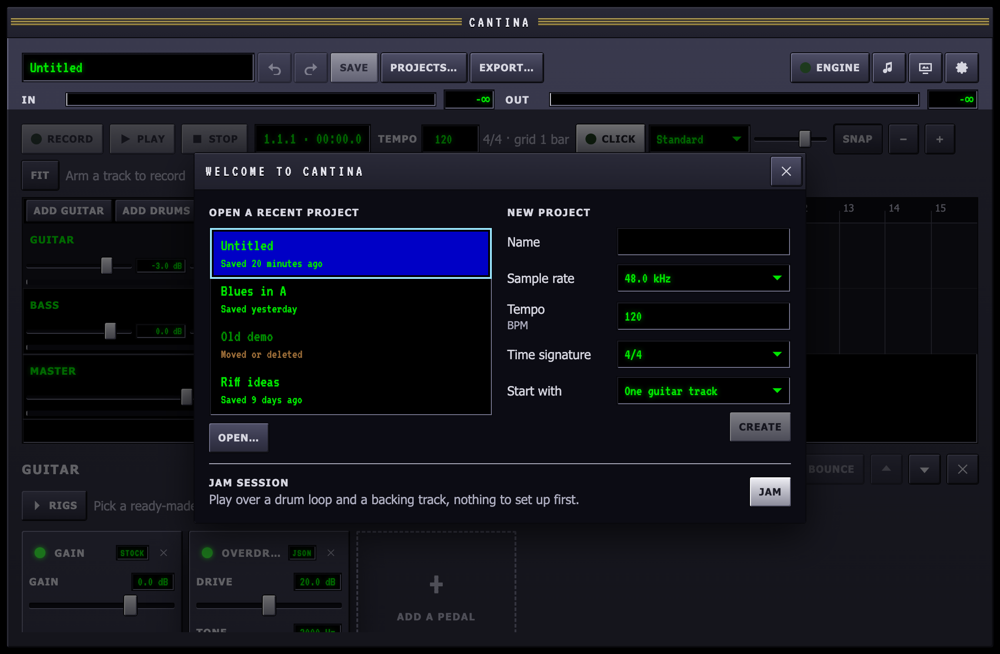
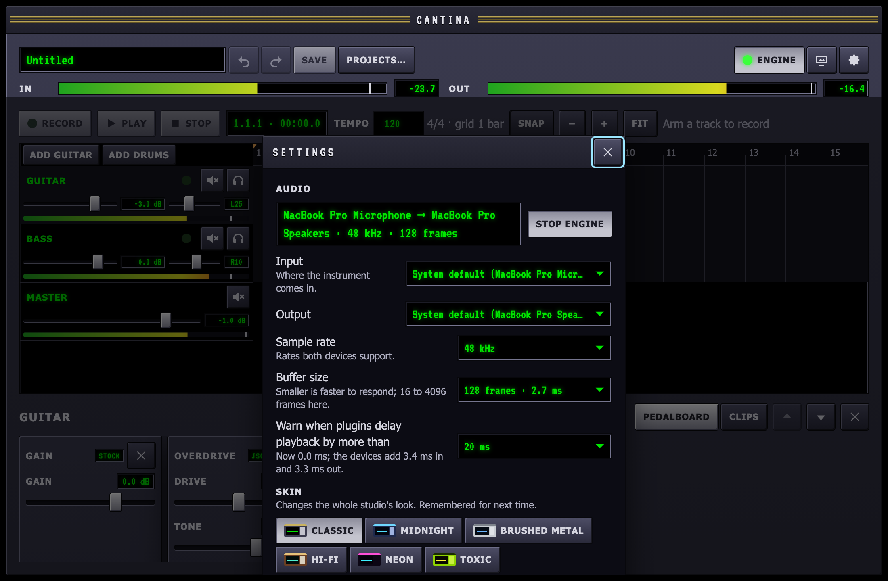
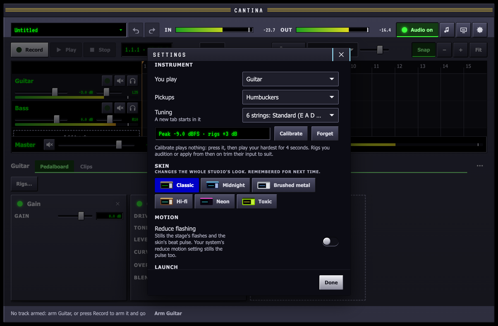
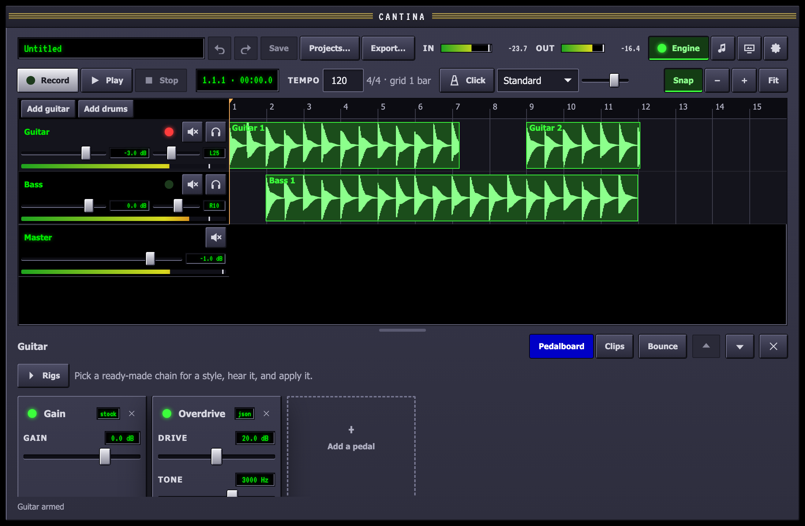
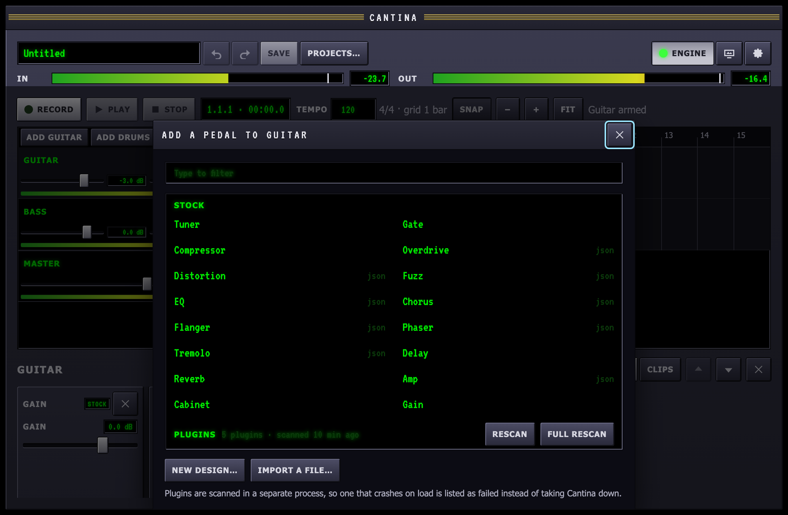

Cantina runs on macOS. This page goes from the download to hearing your
guitar through a pedal chain, in about ten minutes.

## What you need

- A Mac on macOS 13 Ventura or later.
- An audio interface with an instrument input. A class-compliant USB
  interface is all it takes; the built-in microphone works for trying
  things out, but not for playing.
- Headphones or monitors on the interface's output.
- A cable from your instrument to the interface.

## Install

Download `Cantina_<version>_universal.dmg` from the newest
[release](https://github.com/jbouder/cantina/releases/latest). It runs
on Apple silicon and Intel Macs. Open the DMG and drag Cantina into
Applications.

Cantina is not notarized by Apple yet, so the first time you open it
macOS says it cannot check the app for malicious software. Choose
**Done**, open **System Settings → Privacy & Security**, scroll to the
message about Cantina and choose **Open Anyway**. macOS remembers, and
later opens go straight through. (Or, in Terminal:
`xattr -dr com.apple.quarantine /Applications/Cantina.app`.)

Cantina looks for a new release each time it opens and offers to install
it; see **Settings → Updates**.

### Build from source

You need [Rust](https://rustup.rs) (make sure `~/.cargo/bin` is on your
`PATH`) and Node 22 or newer. Then:

```sh
git clone https://github.com/jbouder/cantina.git
cd cantina
npm install
npm run tauri build
open target/release/bundle/macos/Cantina.app
```

The first build compiles the whole Rust workspace and takes a few minutes.
Drag `Cantina.app` into Applications to keep it.

## Open Cantina

Cantina opens with the start dialog, three ways in:

- **Open a recent project**: the projects you had open lately, newest
  first, each with when it was last saved. Return opens the one with
  focus. A project moved or deleted since stays in the list and says
  so. **Open…** lists every project in `~/Music/Cantina`.
- **New project**: a name, the sample rate, the tempo, the time
  signature, and what to start with: one guitar track, guitar and bass,
  guitar and a drum track with a kit, or nothing. The project is made as
  you asked in one step, with nothing to undo.
- **Jam session**: straight into [jam mode](/guides/jam/), drums and a
  backing to play over with nothing to set up.

Escape (or the close key) takes the most recent project, or the new
`Untitled` project Cantina makes the first time. If the last session
quit without saving, Cantina offers to recover those edits first, and
the dialog follows.



To skip the dialog and reopen the last project each time, turn on
**Open the last project at launch** in **Settings → Launch**.

## Pick your interface

Open **Settings** with the gear at the top right. Under **Audio**, choose
your interface as the **Input** and the **Output**, leave the sample rate at
48 kHz, and pick a **Buffer size**. Start at 128 frames; once everything
works, try 64. [Latency](/guides/latency/) explains the trade.



The first time the engine starts, macOS asks whether Cantina may use the
microphone. That is how macOS names every audio input, your interface
included. Allow it, or Cantina hears nothing.

The **Engine** key starts and stops the audio. Its light is on while audio
is running. Your choices are remembered for next time.

## Tell Cantina what you play

Under **Instrument** in Settings, say what you play through: **Guitar** or
**Bass**, the **Pickups** (single coils, humbuckers or active) and the
**Tuning**. The [rigs](/guides/rigs/), ready-made chains for a style, use
it to set how hard they drive their first pedal, so a high-gain rig suits
a hot active pickup and a vintage single coil alike. The tuning is where a
new tab starts.

Then calibrate: with the engine running, press **Calibrate** and play as
hard as you ever do for four seconds. Cantina measures the loudest peak
and shows how much it will trim the rigs by. Calibrate again after you
change the interface's gain knob or pick up another instrument.



## The rest of Settings

The rest of Settings holds the **Skin**, **Motion** (Reduce flashing),
**Launch** (the start dialog, or the last project), the optional **Assistant**, off until you connect a model (see
[The assistant](/guides/assistant/)), and **Updates**.

## Arm a track and play

A new project with one guitar track (`Untitled`, the first time) opens
with a track whose chain is a gain into an overdrive. Click the round light beside the track's name to
arm it; it turns red. An armed track plays your input through its pedals,
so strum: the **IN** meter moves, and you hear the overdrive.



Nothing moving on the **IN** meter means nothing is reaching Cantina; see
[Troubleshooting](/guides/troubleshooting/).

## Add pedals

The pedalboard for the selected track sits under the timeline. For a
tone in one step, press **Rigs** above it and pick one for your style:
metal, rock, blues, funk, jazz, ambient and more, for guitar and for bass.
**Audition** to hear it, **Apply** to keep it; [Rigs](/guides/rigs/) has
the rest.

To build a chain yourself, the dashed
**Add a pedal** slot at the end opens the picker: the stock pedals, the
pedals you have designed, and the Audio Unit and CLAP plugins installed on
your Mac.



Pick one and it is added to the end of the chain, already playing. Drag the
knobs while you play. **×** on a pedal removes it, and every change can be
undone with the arrows next to the project name, or ⌘Z. The
[Pedals](/guides/pedals/) guide covers each stock pedal.

## Record

With a track armed, **Record** (or R) counts in four beats, then starts the
transport and records what comes in; **Stop** (or Space) ends the take, which lands on the track as a
clip. Space plays from the playhead. **Save** (⌘S) writes the project to
`~/Music/Cantina/`, and **Projects…** (⌘O) opens another. The **File**
menu also renames and duplicates projects, reopens recent ones and imports
WAV files; [Menus](/guides/menus/) lists every item.

## Next

- [Recording and editing](/guides/recording/): takes, clips, the mixer and
  the timeline.
- [Drums](/guides/drums/): add a drum track and program a beat.
- [Designing pedals](/guides/designer/): build your own pedal from parts.
- [Jam](/guides/jam/): drums and a backing to play along with, without a
  project; keep the riff you just played.
- [The stage](/guides/stage/): visualizer scenes and performance mode.
