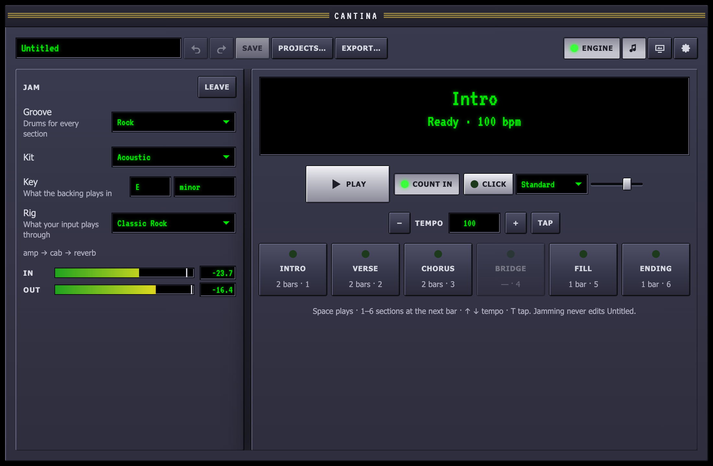
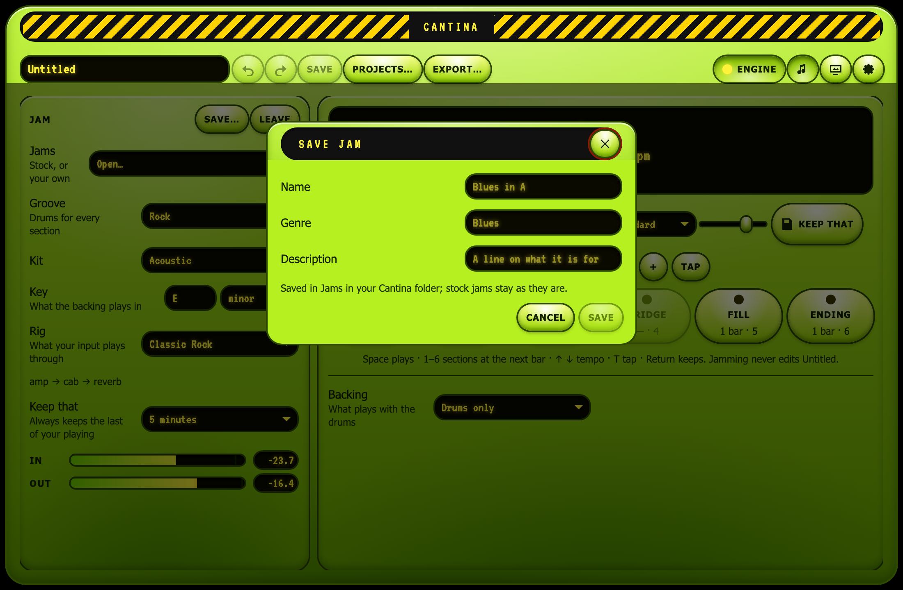
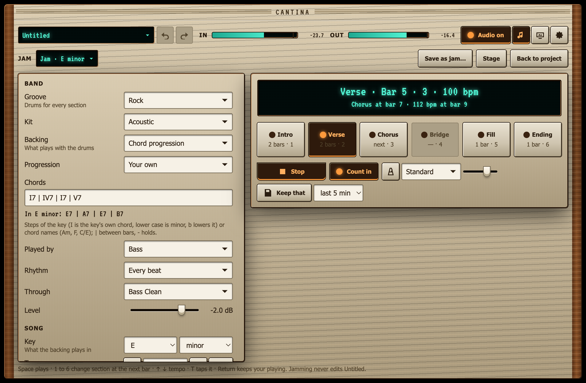
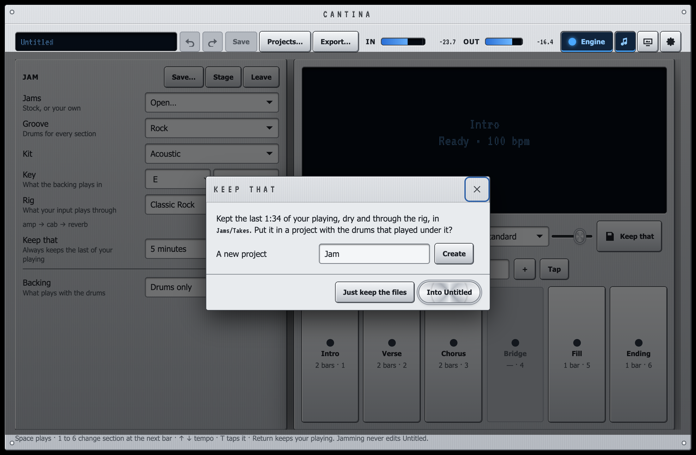

Practising should not mean setting up a project, tracks and clips. Jam
mode is a room of its own: pick a groove, something to play over, a
tempo, the key and the rig you play through, press **Play** and jam. It goes on until you stop it,
and you change section and tempo as you go without stopping.

Jamming never edits the project. The jam is heard *instead of* the
project while it is open, and when you leave, the project is heard again
with its playhead where it was.

## Opening it

Press the **Jam** button (the note) in the title bar, choose
**View ▸ Jam**, or press **J**. Press **Leave**, **J** again or choose
**View ▸ Arrange** to go back to the project. The jam you had last comes
back the next time you open it, tempo and all.

## Setting it up

- **Groove**: the drums. Pick a stock groove's genre, and each section
  plays that genre's pattern for it: Rock has an intro, verse, chorus,
  fill and ending. Or pick **This project's patterns** and choose a
  pattern of the open project for each section you want; the jam keeps
  its own copy, so editing the pattern later does not change the jam.
- **Kit**: the drum kit the groove plays on.
- **Key**: the key a chord progression's numerals count from.
- **Rig**: what your input plays through, any stock rig or one of your
  own (see [rigs](/guides/rigs/)), or **None** to hear it dry. Its chain
  is listed under it. The [instrument profile](/guides/rigs/#your-instrument)
  trims its input as it does for any rig. Pedals that are not installed
  are left out and named.

The meters show your input and what comes out.

## Jams: saving and opening

The **Jams** list at the top opens a jam: one of the stock jams, a
groove, a backing, a tempo, a key and a rig for each common style, or
one of yours. Opening one replaces the jam playing; the music goes on,
with a new tempo from the next bar.

**Save…** writes the jam as it is (groove, backing, progression, tempo,
key and rig) to `~/Music/Cantina/Jams/<name>.jam.json` with a name, a
genre and a line on it. It then shows under *Yours*. Saving under a
name you already have replaces that jam; the stock jams are never
changed. A jam file dropped into that folder appears in the list within
a second, and one that does not load is listed with the reason, as
other library files are. The [jam format](/reference/jam-format/)
describes the file, so you, or a [coding agent](/guides/agents/), can
write one.

The stock jams:

| Jam | Groove | Tempo | Key | Rig | Backing |
| --- | --- | --- | --- | --- | --- |
| Alternative in G | Alternative | 112 | G major | alternative | guitar, `I \| V \| vi \| IV` |
| Grunge in E | Grunge | 100 | E minor | grunge | bass, `i \| bIII \| bVII \| IV` |
| Slow Burn in D | Half-time | 80 | D minor | shoegaze | guitar, `i \| bVI \| bIII \| bVII` |
| Blues in A | Blues shuffle | 96 | A major | blues | bass, the 12-bar blues |
| Minor Blues in E | Blues shuffle | 78 | E minor | blues | bass, the minor blues |
| Country in G | Rock | 112 | G major | country | bass, `I \| IV \| I \| V` |
| Funk in E | Funk | 100 | E minor | funk-clean | bass, `i7 \| i7 \| IV7 \| IV7` |
| Hip-hop in C | Hip-hop | 90 | C minor | jazz-clean | bass, `i7 \| bVImaj7 \| iv7 \| V7` |
| Jazz in B♭ | Jazz | 140 | B♭ major | jazz-clean | bass, `ii7 \| V7 \| Imaj7 \| Imaj7` |
| Djent in B | Djent | 120 | B minor | djent | bass, `i5 \| i5 \| bII5 \| i5` |
| Heavy Metal in E | Heavy metal | 152 | E minor | heavy-metal | bass, `i5 \| bVI5 \| bVII5 \| i5` |
| Metalcore in D | Metalcore | 140 | D minor | metalcore | bass, `i5 \| bVI5 \| bIII5 \| bVII5` |
| Thrash in E | Thrash | 200 | E minor | thrash | bass, `i5 \| i5 \| bII5 \| i5` |
| Pop in C | Pop | 108 | C major | alternative | guitar, `I \| V \| vi \| IV` |
| Punk in D | Punk | 184 | D major | punk | bass, `I5 \| IV5 \| V5 \| IV5` |
| Reggae in A | Reggae | 76 | A major | funk-clean | bass, `I \| IV \| I \| V` |
| Hard Rock in A | Hard rock | 132 | A major | hard-rock | bass, `I5 \| I5 \| bVII5 \| IV5` |
| Rock in E | Rock | 120 | E major | classic-rock | bass, `I \| bVII \| IV \| I` |

## Backing

**Backing**, under the sections, is what plays with the drums:

- **Drums only**.
- **Chord progression**: chords played by a built-in guitar or bass, the
  plucked-string voice that plays [tabs](/guides/tabs/), through a rig of
  their own. It follows the jam's tempo and every change of it.
- **Audio file**: a WAV file of your own, from the first bar, round and
  round. Give **Its tempo** and the drums play at it.
- **A project's track**: an audio track of any project, its clips through
  its chain, round and round from the start of the project to the end of
  the track's last clip. The drums play at the project's tempo.

Audio cannot follow another tempo, so with an audio file or a track the
tempo is the backing's: the tempo controls are off and the drums follow
it. Audio is looped in whole bars, the nearest number to its length, so
a backing a beat short or long still lines up with the bar. Choosing or
leaving an audio backing while the jam plays stops it, to start again in
step. Audio at another sample rate is converted once, to a copy in
Cantina's cache; the file itself is never changed.

**Level** sets the backing against the drums.

### Chord progressions

Pick a **Progression** from the presets, by genre, or type your own into
**Chords**:

| You type | You get |
| --- | --- |
| `I IV V IV` | One chord a bar |
| `I7 \| IV7 \| I7 \| V7` | One a bar, with bar lines |
| `\| ii7 V7 \| Imaj7 - \|` | Two a bar; `-` holds the chord before |
| `Am \| F \| C/E \| G` | Chord names, with a bass note after `/` |

With bar lines, the chords between two of them share the bar equally;
without, each chord is a bar. The progression plays round and round from
the first bar, whatever section the drums are in, and the ending rings
its first chord.

A Roman numeral counts from the key's tonic as a major scale does, in
any mode: in A minor the minor third is `bIII`, so a minor rock
progression is `i | bVI | bVII | i`. An upper-case numeral is a major
chord, a lower-case one minor, and a suffix says the rest: `7`, `maj7`,
`m7`, `6`, `9`, `add9`, `sus2`, `sus4`, `5` (a power chord), `dim` or
`°`, `dim7`, `m7b5` or `ø`, `aug` or `+`. Chord names take the same
suffixes, `m` for minor, and ignore the key.

**Played by** picks the guitar or the bass, **Rhythm** how often each
chord is played (once, on half notes, on every beat or on eighths, the
off-beats strummed up), and **Through** the rig it plays through, from
the rigs for that instrument. The guitar plays barre-chord shapes from
the low E string; the bass plays each chord's bass note.

The presets:

| Genre | Progressions |
| --- | --- |
| Blues | 12-bar blues, quick-change blues, minor blues |
| Rock | I–bVII–IV, I–IV–V |
| Pop | I–V–vi–IV, vi–IV–I–V |
| Punk | Power chords (I5–IV5–V5–IV5) |
| Metal | Aeolian (i5–bVI5–bVII5), Phrygian (i5–bII5) |
| Grunge | i–bIII–bVII–IV |
| Funk | Dorian vamp, one-chord groove |
| Jazz | ii–V–I, turnaround |
| Reggae | I–IV |
| Hip-hop | Minor loop |
| Country | I–IV–I–V |

## Playing

**Play** (or **Space**) starts the jam from the top: from the intro when
the groove has one, then the verse. With **Count in** on, the click
counts a bar first. **Click** turns the metronome on for the whole jam.
**Stop** (or **Space** again) stops and goes back to the top.

The display shows the section playing, the bar and beat, the tempo, and
what is coming: a section or a tempo you asked for, and the bar it lands
on.

## Sections

Press a section, or a number key, to play it from the next bar:

| Key | Section | Plays |
| --- | --- | --- |
| 1 | Intro | Once, then the verse |
| 2 | Verse | Round and round |
| 3 | Chorus | Round and round |
| 4 | Bridge | Round and round |
| 5 | Fill | Once, then back to the section it interrupted |
| 6 | Ending | Once, then the jam stops |

The change lands exactly on the bar line, to the sample, however close
to it you press, as long as there is a moment to spare: pressed in the
last few hundredths of a second of a bar, it waits for the bar after.
Pressing another section before the bar arrives replaces the one that
was coming. A section the groove has no pattern for is greyed out.

While stopped, pressing a section makes the jam start with it, and so
does pressing one during the count-in, up to its last beat.

## Tempo

**−** and **+** (or **↓** and **↑**) nudge the tempo a beat per minute;
with **⇧** by five. Type a tempo into the field, or press **Tap** (or
**T**) on the beat: two taps or more set it, and a pause of two seconds
starts a new count. While the jam plays, a new tempo lands on the next
bar line, like a section. The drums, a chord backing and the click
follow it at once and nothing clicks. With an audio backing the tempo
is the backing's.

## Keep that

The best riff is always the one you were not recording. While a jam is
open, Cantina keeps the last minutes of your playing: your dry input and
the sound through the rig. It is always on; **Keep that** in the jam's
settings says how long it keeps, 1, 2, 5 (the default) or 10 minutes.
Changing it starts afresh.

Press **Keep that** (or **Return**) and those minutes are written to two
files in `~/Music/Cantina/Jams/Takes`: `Jam-1.wav`, the dry take, and
`Jam-1 processed.wav`, through the rig. Then choose where they go:

- **Into** the open project, or a **new project** by name, which is
  opened. Either way it is one edit, so **Undo** takes it back out:
  - **Jam take**, an audio track with the jam's rig as its chain and the
    dry take on it, so you can change the tone later;
  - **Jam take, processed**, muted, with what you heard;
  - **Jam drums**, a drum track on the jam's kit with the sections that
    played under the take, their patterns added to the project.

  The take lines up with the drums on the project's bars. An empty
  project takes the jam's tempo and the take starts at bar 1; a project
  with music in it keeps its tempo, and the take goes after its last bar.
  A project has one tempo, the one the jam ended at: a take that spans a
  tempo change lines up where it starts and drifts from the bars after
  the change.
- **Just keep the files**: the take stays in `Jams/Takes` and nothing
  else changes.

Keeping writes on the recorder's own thread while the jam plays on; the
jam never stops for it.

Keyboard shortcuts work anywhere in the view outside a text field or a
menu; they are listed in [keyboard shortcuts](/reference/shortcuts/).
MIDI control of sections and tempo is not there yet.
