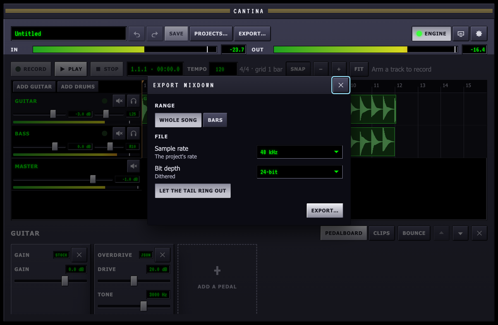

When a song is done it leaves the app as a WAV file. And when a track's
pedals are settled, or the machine is working hard, a bounce renders the
track through its chain to one clip so the pedals no longer run.

Both render the project offline, faster than real time, through the
same pedals, kits and mixer playback uses. What comes out is what you
hear when you play the song from the top.

## Export the mix

Choose **Export…** next to the project name, or press ⌘E.

- **Range**: the whole song, from the start to the end of the last clip,
  or a range of bars. Both bar numbers are counted as the timeline shows
  them, and the last bar is included. A range sounds as it does when you
  play from the top: a delay or reverb from before it rings on into it.
- **Sample rate**: 48 kHz or 44.1 kHz. The project's own rate is
  written as it is; the other is converted with a high-quality resampler
  (flat to 0.05 dB across the audible range, nothing above the new
  Nyquist folding back).
- **Bit depth**: 24-bit is the usual choice. 16-bit is for CDs and
  some upload sites. Both have dither added so quiet fades stay smooth.
  32-bit float writes the mix exactly, with no dither and nothing
  clipped above full scale.
- **Let the tail ring out**: keeps rendering past the end until the
  reverbs and delays have died away (up to ten seconds). Turn it off to
  cut the file exactly at the end of the range.

Then **Export…** asks where to save. A bar shows the progress, and
**Stop** abandons the render. When it is done the sheet says how long
the file is, how much faster than real time it rendered, and its peak
level. A peak above 0 dBFS clips in a 16 or 24-bit file, so pull the
master fader down and export again.

The engine can stay on while you export. Playing and editing carry on,
and the export is of the project as it was when you pressed the button.

## Bounce a track in place

Select the track and choose **Bounce** in the editor's header. Cantina
renders the track's clips, or a drum track's patterns through its kit,
through every pedal that is on, and puts the result on the track as one
clip, from where the track's first clip starts to where its last one's
tail dies away. The pedals come off the chain, because their sound is in
the clip now. A drum track becomes an audio track.

The track's fader, pan, mute and solo are not part of the bounce. They
apply to the new clip as they did to the pedals, so the mix sounds the
same afterwards.

A bounce is one edit. ⌘Z puts the clips and the pedals back, settings
and all, and the bounced file stays in the project's `audio` folder in
case you redo it. Your recorded takes are never changed.

Bounce when:

- a chain of plugins is more than the machine can run along with
  everything else;
- you like a tone and want to keep it while you try other pedals on a
  copy;
- a drum part is finished and you want to edit it as audio.
