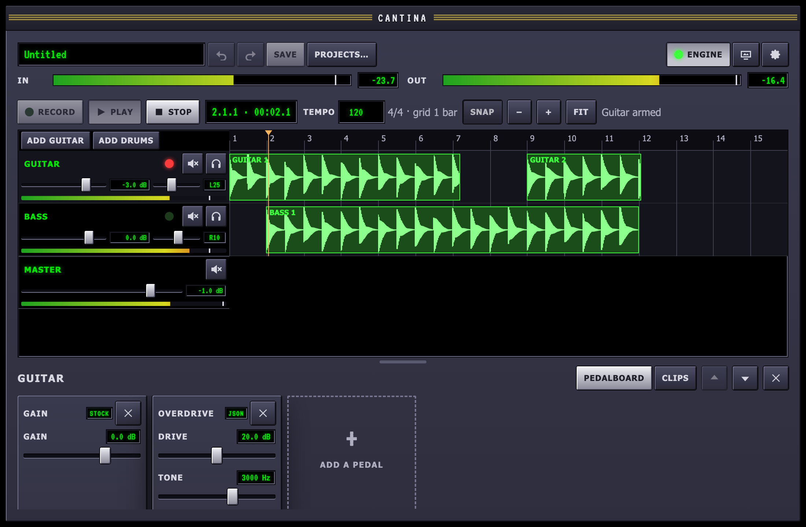
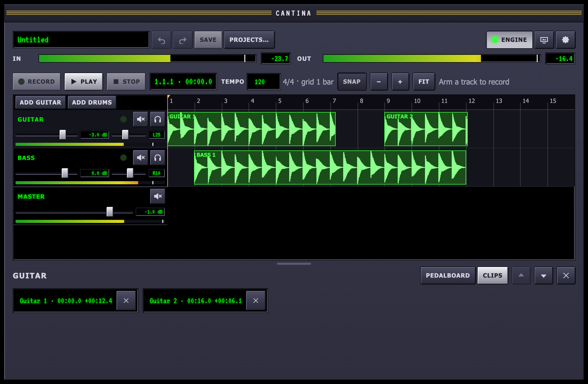

The studio window is an arrangement on top and an editor for the selected
track below, with a divider between them that you can drag. The arrangement
is the transport, the track headers that make up the mixer, and the timeline.

## Tracks

**Add guitar** adds an audio track with an empty pedalboard; **Add drums**
adds a [drum track](/guides/drums/). Click a track's name to select it and
show its editor below. In the editor, click the name to rename the track,
and use ▲ and ▼ to move it up or down or **×** to remove it.

## Record a take

1. Arm the track: click the light beside its name. An armed track plays your
   input through its pedals.
2. Press **Record** or R. The transport rolls from the playhead.
3. Press **Stop** or Space. The take lands on the track as a clip.

Takes are written to the project's folder as they record, and the files are
never changed afterwards: every edit below is to the clips that point into
them. Takes are lined up with what you heard, so latency from the chain and
the interface does not push them late.

## Play and move around

- **Space** plays from the playhead or stops.
- **Click the ruler** to move the playhead.
- The clock shows bars and beats, then minutes and seconds.
- **Zoom** with a pinch or Ctrl and the scroll wheel, the **−** and **+**
  keys, or **Fit** to see every clip. Swipe sideways to scroll. While the
  transport rolls, the view pages to keep the playhead in sight.

## Edit clips

| To | Do |
| --- | --- |
| Move a clip | Drag it, onto another track too. It snaps to the grid. |
| Trim a clip | Drag either edge. The audio stays where it was. |
| Split a clip | Alt-click it where it should split, or select it and press S to split at the playhead. |
| Delete a clip | Select it and press Delete, or use its button on the **Clips** tab. |
| Nudge a clip | Select it and press ← or → to move it one grid step. |

Every edit can be undone with ⌘Z and redone with ⇧⌘Z, or with the arrows
beside the project name. The **Clips** tab of the track's editor lists its
clips, for working from the keyboard.

## Tempo and the grid

Type a tempo in the **Tempo** box. The grid follows it, and the strip says
how fine it is: the grid gets finer as you zoom in, from 32 bars down to a
sixteenth note. **Snap** turns snapping off and on. Drum clips stay on their
bars when the tempo changes.

## Mix

Each track header is a channel strip:

- the **arm** light, or a drum mark on a drum track
- **mute** and **solo**
- a **gain** fader with its readout in dB, and a **pan** fader
- a meter of what the track sends to the master

The **Master** strip under the tracks has the overall gain, a mute and the
output meter. Double-click a fader to reset it.

## Projects

A project is a folder in `~/Music/Cantina/` holding its takes, its settings
and every edit. **Save** writes it, and **Projects…** opens another or
starts a new one with a name of your choosing. If Cantina quits without saving, the next
launch offers to restore the unsaved edits.
