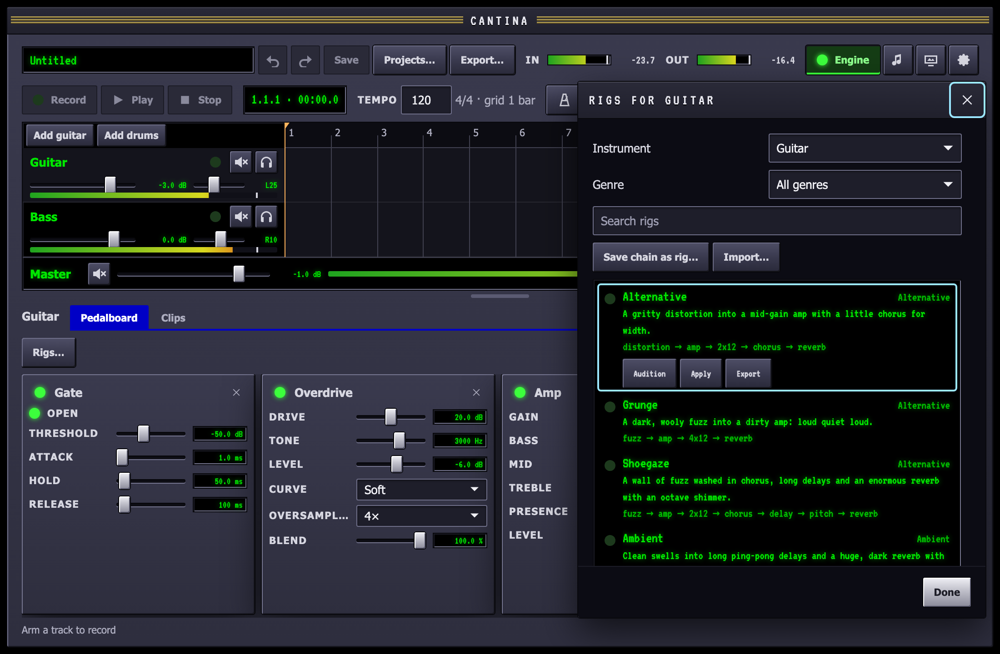
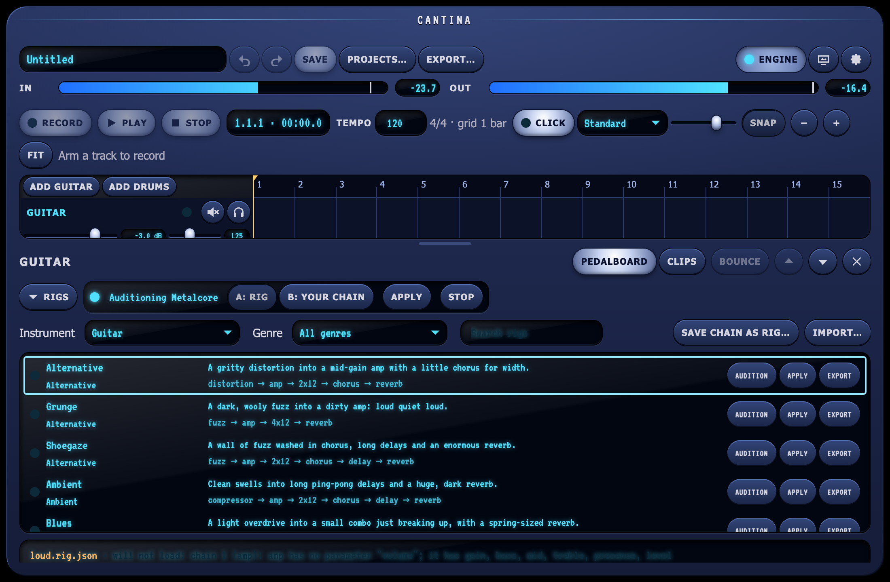
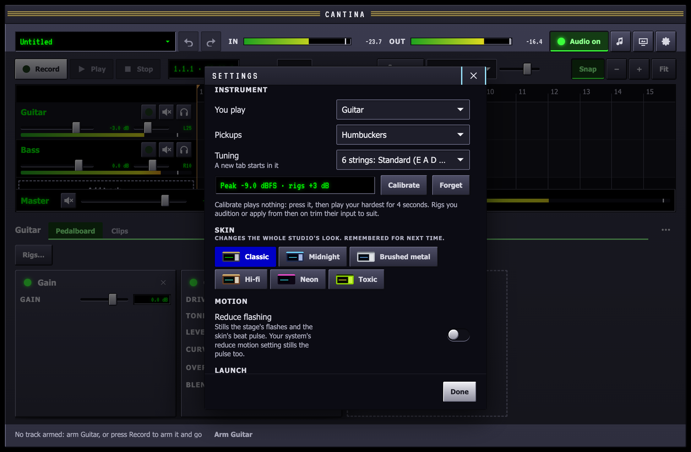

Most of the time you want "a metalcore tone" before you want to know what
a compressor's attack does. A rig is that: a chain of pedals with their
settings for a style, with a name, a genre and a line on what it sounds
like. Cantina ships a rig for each common style, for guitar and for bass,
built from its own stock pedals and cabinets, so every one works on a
fresh install.

## Picking a rig

Select an audio track, open its **Pedalboard** and press **Rigs** above
the chain. The picker lists the rigs for an instrument, guitar or bass,
with each one's genre, a line on what it sounds like and its chain.
Narrow it with **Genre** or by typing in the search.



- **Audition** a rig to hear it on your live input in place of the
  track's chain. Nothing in the project changes: the chain under the
  picker is still yours. The rig being heard has a lit light.
- **A** and **B** flip between the rig and your own chain while you play,
  so you can compare them. The swap fades the track out and back in over
  a few hundredths of a second, so it never clicks.
- **Apply** replaces the track's chain with the rig's, as one edit:
  **Undo** puts your chain back. Applying also ends the audition.
- **Stop** ends the audition and puts your chain back.



Applied, a rig is ordinary pedals: turn knobs, add, remove and reorder
them as with any chain. When the rig's own input gain and your
[instrument profile](#your-instrument)'s trim add up to anything, it
starts with a **Gain** pedal set to that.

From the keyboard the list is one tab stop: ↑ and ↓ move through it,
Space auditions the rig under the cursor (again stops), Return applies
it and Esc stops the audition. Double-clicking a rig applies it.

If a rig names a plugin, a designed pedal or an impulse response that is
not installed, the rest of it still plays: the picker and a notice say
which pedals were left out and why.

## Your instrument

The same rig sounds very different into different pickups: a high-gain
rig that is tight on a humbucker turns to mush on hot active pickups and
thin on a vintage single coil. So rigs trim their input to suit what you
play, from the **instrument profile** in **Settings ▸ Instrument**:

- **You play**: guitar or bass. The picker opens on that instrument's rigs.
- **Pickups**: single coils, humbuckers or active. Until you calibrate,
  rigs trim by a nominal amount for them: +4 dB for single coils, nothing
  for humbuckers (the stock rigs are leveled for a passive humbucker), −6
  dB for active pickups.
- **Tuning**: where a new tab starts when you transcribe a clip.
- **Calibrate**: with the engine running, press it and play as hard as you
  ever do for four seconds. Cantina measures the loudest peak at the input
  and from then on trims rigs so that peak lands at −6 dBFS, the level the
  stock rigs are leveled for: a peak of −12 dBFS gives rigs +6 dB. The
  display says what it measured and the trim. **Forget** goes back to the
  nominal trim. Calibrate again when you change the interface's gain knob
  or another instrument; a calibration that heard nothing, or clipped,
  says so and keeps the old one.



The trim is part of the leading **Gain** pedal a rig gets when you
audition or apply it, so you can see it and change it. Chains already on
your tracks keep their levels when the profile changes; apply the rig
again to pick up the new trim. The profile is an app setting, not part of
a rig or a project: a rig file says nothing about your instrument, and
[`cantina-cli render rig`](/reference/cli/#render-rig) renders it exactly
as written.

## Saving and sharing your rigs

**Save chain as rig…** writes the track's chain, every knob as it is, to a
rig of your own: give it a name and, if you like, a genre, the instrument
and a line on what it sounds like. It appears in the picker straight away,
marked *yours*. Saving under a name you already used replaces that rig. A
**Gain** pedal first in the chain is saved as the rig's input gain, less
your profile's trim, so the rig sounds the same applied again, here or on
someone else's instrument.

Your rigs are files, one `<name>.rig.json` each, in
`~/Music/Cantina/Rigs`, a library folder Cantina watches like the others:

- **Rename** and **Delete** a rig of yours from its row. The stock rigs
  are read-only.
- **Export** writes a copy of any rig to wherever you choose, to send to
  someone.
- **Import…** takes a rig file someone sent you, checks it and copies it
  into your Rigs folder.
- A rig file dropped into `~/Music/Cantina/Rigs` by hand or by a coding
  agent shows up within a second, no restart. One that does not load is
  listed under the rigs with the reason, the same one `cantina-cli check`
  gives, until it is fixed.

A plugin in a rig carries its whole saved state, so it comes back exactly
as it was, on any Mac that has the plugin. A designed pedal is named by
its id: the person you share with needs the pedal file too, so save it to
your library and send both. Cantina reminds you when a rig uses a design
only the project has.

A [jam](/guides/jam/) plays your input through a rig too, and its chord
backing through another, both picked by name.

## The stock rigs

Every stock rig is leveled against the same DI, so switching from one to
another does not jump in volume: they sit within 6 dB of each other, the
clean ones a little quieter so their peaks have room.

### Guitar

| Rig | Genre | What it sounds like | Chain |
| --- | --- | --- | --- |
| Metalcore | Metal | Tight, gated high gain with a boosted front end and a scooped mid for chugs and breakdowns. | Gate, Overdrive, Amp, 4x12, Reverb |
| Heavy Metal | Metal | Classic heavy metal: a hot distortion into a cranked amp, mids intact, a touch of delay for leads. | Gate, Distortion, Amp, 4x12, Delay, Reverb |
| Thrash | Metal | Fast and dry: deep scooped mids, a tight gate and nothing hanging off the end. | Gate, Overdrive, Amp, 4x12 |
| Djent | Metal | Percussive extended-range gain: low end cut before the amp, mids forward and a sharp gate. | Gate, Overdrive, EQ, Amp, 4x12, Reverb |
| Hard Rock | Rock | An overdrive pushing a crunchy amp: big chords and singing leads. | Overdrive, Amp, 4x12, Reverb |
| Classic Rock | Rock | An amp on the edge of breakup, mids up, through a closed two-twelve in a warm room. | Amp, 2x12, Reverb |
| Alternative | Alternative | A gritty distortion into a mid-gain amp with a little chorus for width. | Distortion, Amp, 2x12, Chorus, Reverb |
| Grunge | Alternative | A dark, wooly fuzz into a dirty amp: loud quiet loud. | Fuzz, Amp, 4x12, Reverb |
| Shoegaze | Alternative | A wall of fuzz washed in chorus, long delays and an enormous reverb with an octave shimmer. | Fuzz, Amp, 2x12, Chorus, Delay, Pitch, Reverb |
| Punk | Punk | Bright, aggressive distortion with the mids left in: three chords and the truth. | Distortion, Amp, 2x12 |
| Blues | Blues | A light overdrive into a small combo just breaking up, with a spring-sized reverb. | Compressor, Overdrive, Amp, 1x12, Reverb |
| Funk Clean | Funk | Squashed and sparkly: a fast compressor into a clean amp, mids scooped for scratches. | Compressor, Amp, 1x12, Reverb |
| Jazz Clean | Jazz | Warm and round: a clean amp with the treble rolled off and a soft room. | Compressor, Amp, 1x12, Reverb |
| Country | Country | Snappy chicken pickin': hard compression, a bright clean amp and a slapback echo. | Compressor, Amp, 1x12, Delay, Reverb |
| Ambient | Ambient | Clean swells into long ping-pong delays and a huge, dark reverb with an octave-up shimmer. | Compressor, Amp, 2x12, Chorus, Delay, Pitch, Reverb |

### Bass

| Rig | Genre | What it sounds like | Chain |
| --- | --- | --- | --- |
| Bass Clean | Clean | Round and even: gentle compression into a clean bass amp and a four-ten. | Compressor, Amp, 4x10 |
| Bass Rock | Rock | Growl with the mids pushed so the bass cuts through loud guitars. | Compressor, Amp, 4x10 |
| Bass Metal | Metal | A tight gate, a hard distortion and a clanky top end that locks with the kick. | Gate, Compressor, Distortion, Amp, 4x10 |
| Bass Funk | Funk | Slap-ready: heavy compression, deep lows, scooped mids and a bright top. | Compressor, Amp, 4x10 |

The cabinets are Cantina's synthesised [starter impulse
responses](/guides/pedals/); a rig sounds more like a real amp in a room
through a captured one. Drop your own into `~/Music/Cantina/IRs` with the
same name to replace a stock one everywhere.

## Writing your own

A rig is a JSON file, `<id>.rig.json`, described on the [rig
format](/reference/rig-format/) page: the pedals in order, each with its
parameters by name. Check it and hear it by the numbers with
[`cantina-cli`](/reference/cli/):

```sh
cantina-cli check my-tone.rig.json
cantina-cli render rig my-tone.rig.json      # through the DI of its instrument
```

`render rig` plays a guitar rig through the guitar DI and a bass rig
through the bass DI, and prints the peak, the RMS level, the DC offset and
the chain's latency. Set the amp's `level` so the RMS sits near -19 dBFS
with the peak under -1.5 dBFS, as the stock rigs do, and your rig will
sit with them. A coding agent with the [authoring
skill](/guides/agents/) knows the format and does this loop for you.
