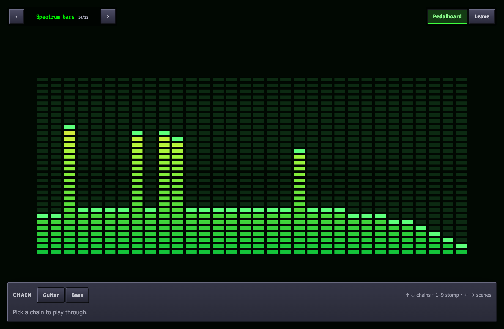

The stage draws a visualizer scene from what you play: its spectrum,
waveform, level and beat. While the transport rolls, the beat comes from
the project's tempo, so scenes pulse in time.

## The stage sheet

The stage key, the screen beside **Engine**, or **View ▸ Stage** opens a sheet with the scene, a scene
picker, and **Listens to**: the master, or one track's post-fader signal.
The scene is remembered for next time and shared by every place the
stage is drawn.

## Performance mode

**P** anywhere in the studio, or **Perform** on the stage sheet, fills the
screen with the scene; the window goes full screen and the engine runs on
underneath untouched, so audio does not stop or glitch on the way in or
out. Space still plays and stops.

| Key | Does |
| --- | --- |
| ← → | Previous and next scene, crossfading over 400 ms |
| B | Shows or hides the pedalboard |
| ↑ ↓ | Switches chains |
| 1–9 | Stomps the live chain's pedals: bypass or back on |
| D | Sends the stage to the other display, or brings it back |
| Esc | Leaves performance mode |

The **pedalboard** is translucent over the scene. Its top row is the
chains: one per audio track, and the one lit is the one the input plays
through. Switching chains arms that track and disarms the others in one
edit, so a clean and a lead sound are two tracks with their own pedals.
Below are the live chain's pedals as stomps: the LED is lit while the
pedal is on, and pressing it bypasses the pedal, which keeps its
settings. Bypass is saved with the project and is
undoable like any edit; a bypassed pedal adds no latency.

## A second display

With a second display connected, **Second display** (or D, or **Window ▸
Stage on Second Display**) opens the
stage full screen on it in a window of its own, while the studio window
stays where it is. The stage window draws from the same frames and
follows the scene the studio picks; the studio shows a note in its place
so the scene is not drawn twice. With one display, the key says to
connect another.

## Reduce flashing

Settings has **Reduce flashing**, remembered for next time, which stills
the scenes' strobing beat effects and the skin's beat pulse.

The scenes are shared with the music-visualizer project, in
`packages/scenes`; how they get their data is in
[frames](/architecture/frames/#analysis).
