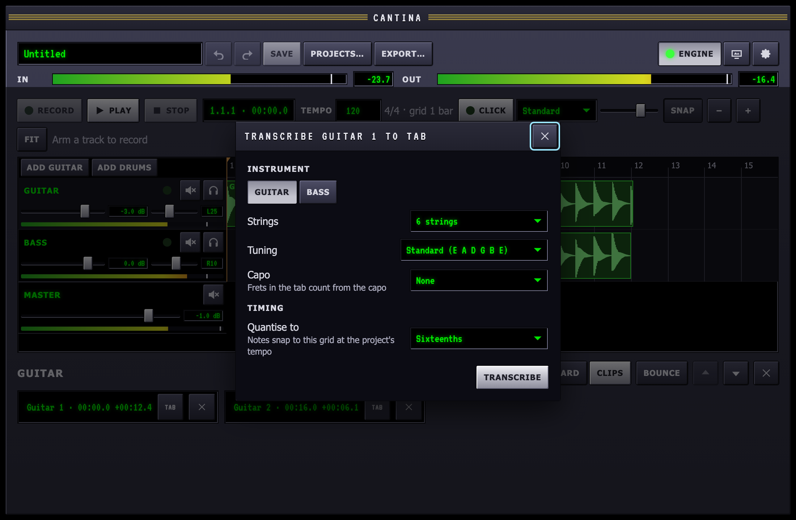
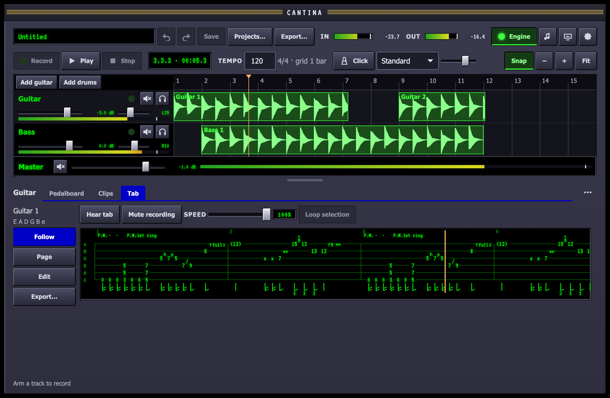
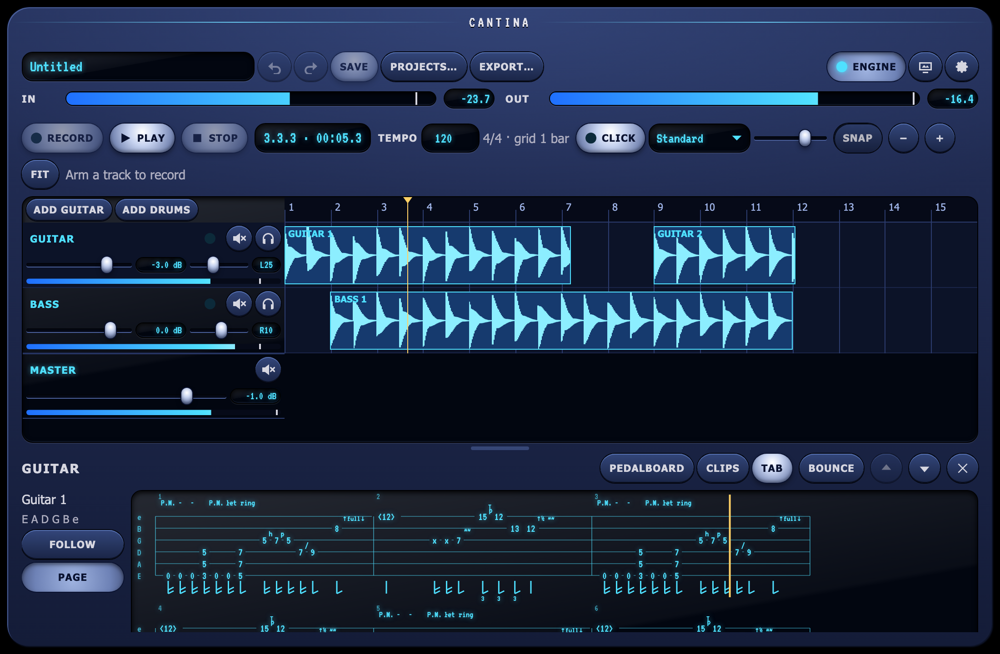
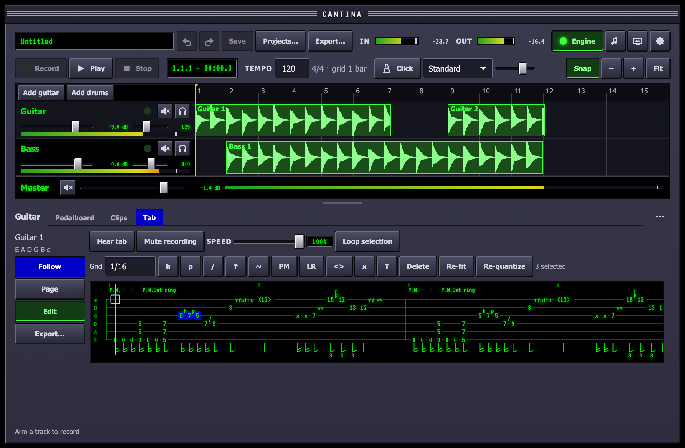
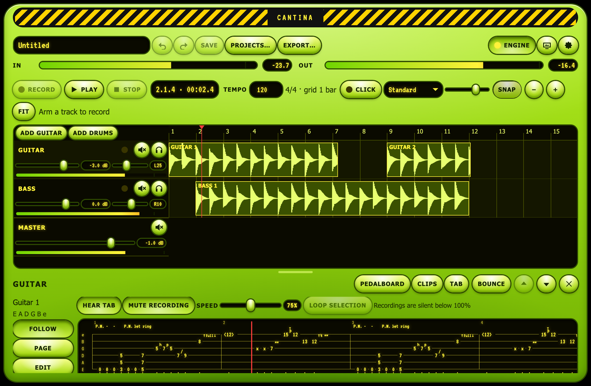

A tab shows where to play each note: which string, which fret, and how.
Cantina writes one from a clip you recorded, and keeps it on that clip.
This guide grows with the tab features; for how transcription works and
how accurate it is, see the [transcription](/architecture/transcription/)
architecture page.

## Transcribe a clip

1. Open the track's **Clips** tab and press **Tab** beside the clip.
2. Choose the instrument (guitar or bass), the number of strings, the
   tuning and the capo.
3. Choose the grid to quantise to: sixteenths, eighths, or their
   triplets. Notes snap to it at the project's tempo.
4. Press **Transcribe**. A bar shows progress; **Stop** cancels and
   leaves everything as it was.

Transcription runs on your Mac; the recording is never sent anywhere,
and the audio file is never changed. A three-minute take takes a few
seconds. The clip's line in the list then says **tab**. Adding the tab is
one edit, so ⌘Z takes it away again.

The tab sits on the clip. Move, trim or split the clip and the tab stays
on the notes it describes; both halves of a split keep it.

### Quantising again

If the notes landed on the wrong grid, triplets where you played
sixteenths say, press **Tab** again, choose another grid and press
**Re-quantise**. Cantina keeps what it heard, so this is instant and
does not listen to the recording again. **Transcribe again** starts over,
with a new tuning for instance.

### What transcription gets wrong

Transcription hears pitches, not hands, and it is not perfect. On test
recordings it finds about three notes in four. Expect to fix:

- **Extra notes in distorted chords.** Distortion adds tones that are
  not played, often an octave below the root. Cantina moves notes that
  are too low for the instrument back up, which fixes most of these.
- **Harmonics heard as notes.** A single low note can come with a quiet
  octave or twelfth. Cantina drops these over single notes but keeps the
  octave in a chord, so a played double stop of root and octave can lose
  its top note.
- **Bends heard as two notes.** Most become one bent note; a fast bend
  may not.
- **Note ends.** Where a note stops is much less reliable than where it
  starts. Quantising tidies most of this.
- **Strums.** The strings of a strum are snapped together onto the beat.
- **Fast legato, fret noise and heavy gain on single notes** are harder
  than anything Cantina was tested on.

Slides, vibrato and harmonics are not detected; mark them yourself.

## Read a tab

When a track has a clip with a tab, its editor gains a **Tab** tab below
the timeline. If more than one clip has a tab, choose one at the top
left.

- **Strings and frets.** Each line is a string, the highest at the top,
  named on the left in the tab's tuning. The numbers are frets, counted
  from the capo.
- **Bars** are numbered above the staff, at the tempo and time
  signature the tab was written in: the project's when it was
  transcribed, so they line up with the timeline's bars.
- **Rhythm** is under the staff: a stem for a quarter note, flags for
  eighths and sixteenths, a short stem for a half note, nothing for a
  whole note, a dot for a dotted note and a 3 under a triplet.
- **The cursor** follows the playhead. Click anywhere on the tab to move
  the playhead there. With the tab focused, ← and → move a beat, Page Up
  and Page Down a bar, and Home goes to the start.
- **Trimmed notes** that the clip no longer plays are shown faded.

**Follow** shows the tab as one line that scrolls with playback, for
playing along. **Page** wraps the bars into rows across the panel, for
reading ahead; drag the panel's top edge up to see more rows.

### Technique marks

| Mark | Means |
| --- | --- |
| `h` | Hammer-on: sound the note by hammering onto the fret |
| `p` | Pull-off: sound the note by pulling off to it |
| `/` and `\` | Slide up or down into the next note |
| `↑full`, `↑½`, `↑1½` | Bend up a whole step, a half step, a step and a half |
| `↓` after a bend | Release the bend back down |
| `~~` | Vibrato |
| `<12>` | Natural harmonic over the 12th fret |
| `x` | Dead note: a muted click |
| `T` | Tap with the picking hand |
| `P.M. - -` | Palm mute, for as long as the dashes run |
| `let ring - -` | Let the notes ring into each other |

## Fix a tab

Press **Edit** beside the tab. A box, the caret, marks where typing goes:
a string and a grid step. Choose the step with **Grid**: eighths,
sixteenths or their triplets.

- **Type frets.** Move the caret with the arrow keys, ↑ and ↓ between
  strings and ← and → a grid step, and type a fret. A note there gets the
  fret; otherwise a new note one step long starts there. Type two digits
  quickly for frets 10 to 24.
- **Select notes.** Click a note; ⇧-click adds or removes one; ⌘A selects
  them all, and Esc clears the selection. With nothing selected, an edit
  works on the note under the caret.
- **Move and resize.** ⌥← and ⌥→ move the notes a grid step. ⌥↑ and ⌥↓
  move them to the next string, keeping the pitch, so the fret changes;
  a note that would fall off the neck stays put. ⇧← and ⇧→ shorten and
  lengthen them.
- **Techniques.** Press a letter, or its button: H hammer-on, P pull-off,
  S slide, B bend (each press steps through ½, full, 1½ and off),
  V vibrato, M palm mute, L let ring, N harmonic, X dead note and T tap.
  A letter turns the technique off when every selected note has it.
- **Delete** with ⌫.

Every edit is one step of **Undo**, and is kept if the app quits
unexpectedly. The [shortcut reference](/reference/shortcuts/) lists the
keys under **Tab editor**.

### Re-fit and re-quantise a passage

**Re-fit** places the selected notes on the fretboard again, as one hand
position, keeping their timing and techniques: useful after moving a
passage by hand, or to bring a run that jumps around the neck into one
place. Notes outside the selection are left alone, and dead notes and
harmonics stay where they are.

**Re-quantise** builds the selected notes again on the chosen grid, from
what Cantina heard, so a bar of triplets can be fixed without touching
the sixteenths around it. It finds the heard notes of the same pitch that
started within a beat of each selected note. It is there only for a tab
that was transcribed.

With nothing selected, both work on the whole tab.

## Play and practise

Above the tab are the practice controls. They are not part of the
project: nothing is saved, and Undo does not see them.

- **Hear tab** plays every tab in the project through a plucked-string
  voice, a guitar or a bass to match the tab. It plays into the track's
  pedals, so it has your tone, and it plays bends, vibrato, palm mutes,
  dead notes and harmonics. It is a simple synthesised string, there
  to check the notes and learn the part, not to replace the take.
- **Mute recording** silences the recordings on tracks that have a tab,
  so you can play the part yourself. Drums and other tracks play on.
- **Loop selection** loops playback from the first selected note to the
  end of the last. Select notes with **Edit** on; turn the loop off with
  **L** or on the timeline as usual.
- **Speed** slows the click, the drums and the tab voice to between 50%
  and 100%, without changing their pitch. Double-click it for 100%.
  Recordings cannot be slowed yet, so they are silent below 100%, and
  recording waits until the speed is back at 100%.

## How frets are chosen

The same note can be played in several places. An E above middle C is
the open first string, the 5th fret of the second, the 9th of the third,
and so on. Cantina chooses the way a player would:

- **Chords keep their shape.** The notes of a chord stay within a
  stretch of a few frets and on strings next to each other, so a G5 comes
  out as 3-5-5 on the lowest three strings, and an open G as 320003.
- **The hand moves as little as it can.** A riff or a scale stays in one
  position instead of jumping around the neck.
- **Open strings in low positions.** Near the nut, open strings are used
  where a player would use them; higher up they are avoided.
- **Ringing notes are left to ring.** A new note goes on another string
  when the one it could use is still sounding.
- **A repeated note stays put.** Pick the same A four times and it is
  the same fret on the same string each time.

Before choosing frets, Cantina corrects the mistakes transcription is
known to make: a note too low for the instrument (often a driven chord's
root, heard an octave low) moves up an octave, a quiet octave or twelfth
over a single note is dropped as the string's own harmonic, and a bend
heard as two notes becomes one bent note.

It also guesses a few techniques from the recording: a soft note straight
after another on the same string is a hammer-on (going up) or a pull-off
(going down), a short low note in a chug is palm-muted, and a note whose
pitch rose is a bend. Slides, vibrato and harmonics are left for you to
mark.

## Tunings

A tab knows its instrument's tuning and capo, and frets are counted from
the capo:

- **Guitar** with 6, 7 or 8 strings, and **bass** with 4, 5 or 6.
- **Any tuning**: standard, drop D, DADGAD, open tunings, a step down,
  or a baritone in B. A note below the lowest string moves up an octave.
- **Capo**: with a capo at the 2nd fret, the open low string is fret 0
  and sounds F♯.

The tab file format is on the [tab schema](/reference/schemas/tab/) page.
